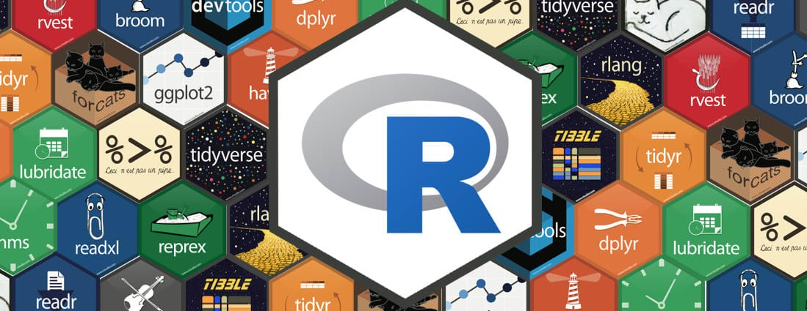
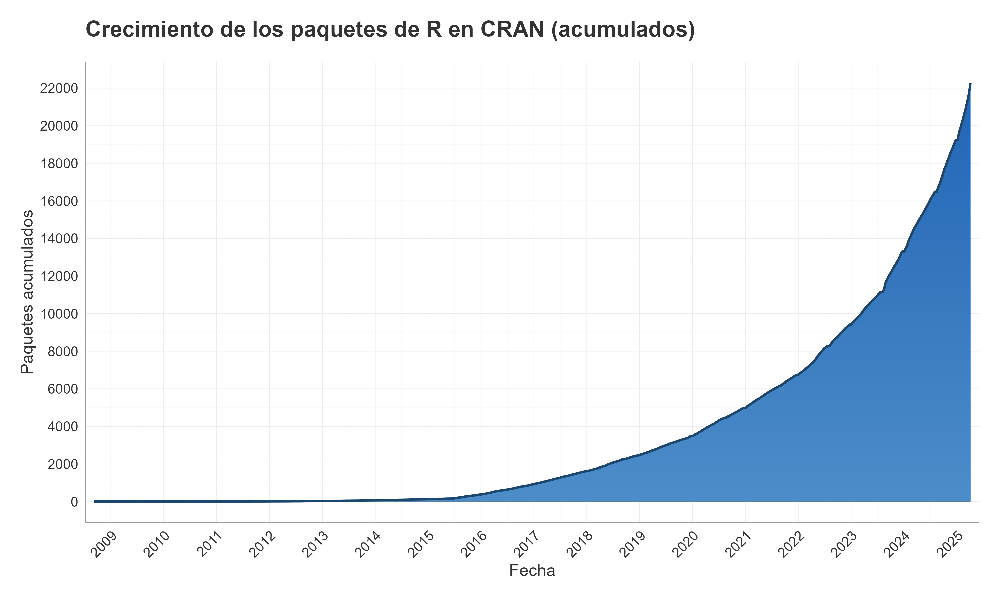
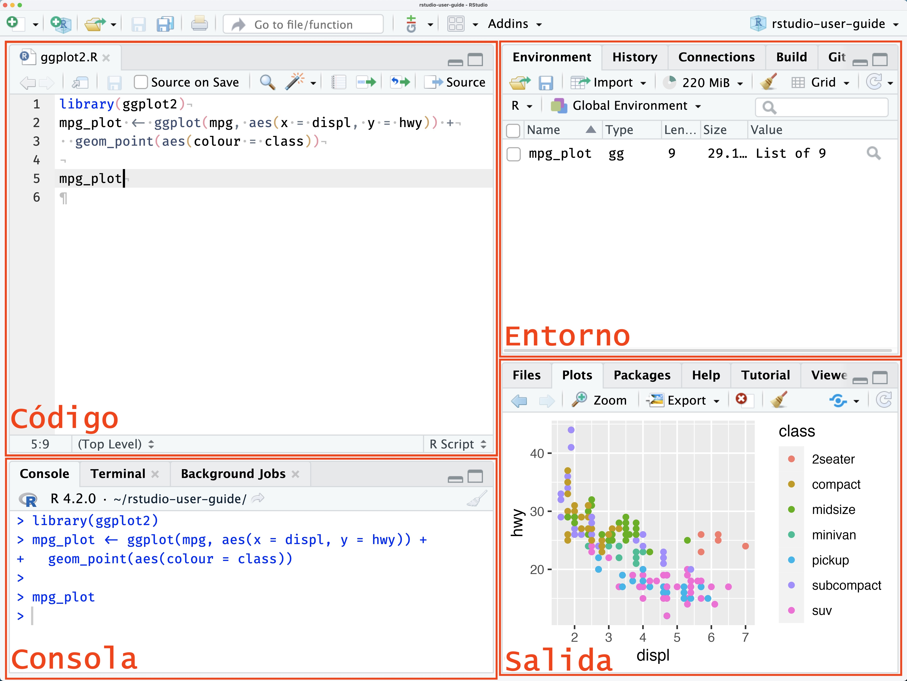

---
title: "Introducción a la programación en R"
---



## ¿Qué es R?

R es un lenguaje de programación y entorno de software libre que ha revolucionado el análisis estadístico y la visualización de datos. Desarrollado durante los años 90 en la Universidad de Auckland (Nueva Zelanda), está inspirado en el lenguaje S creado en los años 70, pero con una arquitectura orientada a la colaboración científica y académica.

En 1995, R fue lanzado como software de código abierto, alcanzando su versión 1.0 en el año 2000. Desde entonces, ha experimentado un crecimiento exponencial, consolidándose como herramienta fundamental para profesionales e investigadores en múltiples disciplinas que requieren análisis de datos robustos. Si quieren saber más al respecto pueden llamar a la función `contributors()`en la consola de R.

El Comprehensive R Archive Network (CRAN), fundado en 1997, constituye el repositorio principal de paquetes para R. Actualmente alberga más de 22.000 paquetes que abarcan desde modelos estadísticos tradicionales hasta implementaciones avanzadas de machine learning y sistemas de visualización de datos de alto rendimiento. CRAN garantiza la estabilidad y compatibilidad del ecosistema R, aunque su riguroso proceso de validación ha dado lugar a prácticas complementarias en la comunidad. Muchos desarrolladores publican versiones preliminares de sus paquetes en plataformas como GitHub, donde la comunidad puede examinarlos y contribuir a su mejora antes de su incorporación oficial al repositorio CRAN.



En 2011, la empresa Posit (antes RStudio) lanzó RStudio, un entorno de desarrollo integrado que transformó la accesibilidad y usabilidad de R. Su interfaz gráfica facilitó la escritura de código, la depuración y la gestión de proyectos, consolidándose como la herramienta estándar para trabajar con R.

Un desarrollo clave en la evolución de R ha sido el tidyverse, un conjunto de paquetes diseñados para simplificar la manipulación y análisis de datos. Creado por Hadley Wickham y su equipo en Posit, el tidyverse sigue principios de diseño coherentes, basados en el concepto de tidy data, donde cada columna es una variable y cada fila es una observación.

Entre los paquetes más destacados del tidyverse se encuentran:

-   {ggplot2} → Visualización de datos.
-   {dplyr} → Manipulación y transformación de datos.
-   {tidyr} → Limpieza y estructuración de datos.
-   {readr} → Importación de datos.
-   {purrr} → Programación funcional.
-   {tibble} → Data frames mejorados.

Con el tiempo, el enfoque tidy ha ganado popularidad, inspirando otros paquetes como {tidymodels} (modelado estadístico y machine learning), {tidytext} (análisis de texto) y {tidygraph} (análisis de redes). Este ecosistema ha desplazado en gran medida el enfoque base de R y se ha convertido en el estándar en la comunidad de análisis de datos.

A su vez, en los últimos años R ha experimentado cambios tendientes a generar mayor interoperabilidad con Python, y expansión hacia tecnologías como Quarto.

### Diferencias con STATA y SPSS

-   Gratuito y de código abierto
-   Únicamente funciona por líneas de código (No hay botones para ejecutar comandos)
-   Posibilita trabajar con múltiples bases de microdatos al mismo tiempo, sin mayor dificultad (No requiere abrir cada base, trabajarla por separado y luego cerrarla)
-   Totalmente automatizable
-   Extensible a otros lenguajes y usos (como esta presentación)
-   Muy superior en capacidad de visualización
-   Más veloz

## Paneles

La interfaz de usuario de RStudio tiene 4 paneles principales:

-   **Panel de Código**

-   **Panel de Consola**

-   **Panel de Entorno**

-   **Panel de Salida**



### Panel de Código

En el panel de código es donde van a trabajar sobre los scripts. Se ubica normalmente en la parte superior izquierda.

Les permite, si quieren, abrir scripts en ventanas separadas, lo cual resulta útil para distribuir el trabajo entre múltiples monitores. Dicha función se activa con el botón a la izquierda del ícono de guardado.

### Panel de Consola

Por defecto la consola se encuentra en la esquina inferior izquierda. Es aquí donde se ejectua el código: pueden escribir en un script y mandarlo a la consola, o, ejecutarlo directamente allí.

Además, contiene una pestaña para correr comandos en la terminal del sistema operativo que sus computadoras.

### Panel de Entorno

Ubicado en la esquina superior derecha, este panel por defecto contiene las pestañas de **Entorno**, **Historial**, **Conexiones**. Las pentañas **Git** y **Build** aparecen cuando uno trabaja con control de versiones con Git (cómo aprenderemos al final de la diplomatura) y cuando uno está construyendo un paquete, respectivamente.

Aquí podrán observar los objetos de R actualmente guardados y accesibles su sesión de R.

### Panel de Salida

Lo verán abajo y a la derecha. Contiene las pestañas de **Archivos**, **Gráficos**, **Paquetes**, **Ayuda**, **Visor** y **Presentación**.

La pestaña que más nos interesará será la de **Archivos** (el resto se activarán automáticamente cuando, por ejemplo, creen y visualicen un gráfico). Ésta les proporcionará una exploración interactiva del Proyecto R actual junto con todo el directorio. Encontrarán opciones para añadir nuevas carpetas, nuevos archivos en blanco, eliminar/renombrar archivos, así como un panel de configuración (icono de engranaje) para funciones adicionales.

## Diferencia entre proyectos y scripts

### Scripts:

Los scripts en R son archivos de texto (.R) que permiten estructurar el código de manera modular, una hoja donde se escribe código. Esto significa que cada segmento del análisis, o cada tarea específica, se puede desarrollar de forma independiente, facilitando la confección, organización y la reutilización del código. Además, esta estructura modular confiere una gran flexibilidad, ya que permite ejecutar o modificar bloques de código sin necesidad de reestructurar todo el proyecto, lo cual es ideal para realizar experimentos rápidos o pruebas puntuales. Sumado a esto, el uso de scripts posibilita documentar detalladamente cada paso del proceso, lo que resulta de gran ayuda para la depuración y para revisar el trabajo hecho.

### Proyectos R:

Un proyecto en R es, esencialmente, un contenedor que agrupa todos los elementos necesarios para desarrollar un análisis o una aplicación, tales como el código, los datos, los resultados y las configuraciones específicas. Al abrir un proyecto, se establece automáticamente el directorio de trabajo y se cargan los ajustes predefinidos, lo que facilita el uso de rutas relativas (en inglés, *relative paths*) sin importar la ubicación de la carpeta del proyecto.

Esta estructura organizada mejora la reproducibilidad y la colaboración, ya que permite compartir el trabajo o trasladarlo a diferentes computadoras sin que pierda coherencia. Además, los proyectos gestionan la integración con Git, un aspecto que profundizaremos en las últimas clases de la diplomatura.

La forma típica de comenzar a trabajar en R es haciendo doble clic en el archivo `.Rproj`. También es posible (y muy cómodo) acceder a los proyectos abiertos recientemente desde la esquina superior derecha de la interfaz.

### Su uso conjunto:

Les recomendamos trabajar con un `.Rproj` (un proyecto) para cada análisis o trabajo. Al hacerlo, se centraliza la configuración del entorno, las rutas de acceso y demás ajustes, lo que garantiza uniformidad durante todo el proceso. Sobre esa base, se recomienda dividir el código en diferentes scripts, asignando a cada uno tareas específicas —por ejemplo, uno para la limpieza de datos, otro para el análisis exploratorio y un tercero para la generación de gráficos—. Esta separación no solo simplifica el mantenimiento y la reutilización del código, sino que también mejora la colaboración en equipo, permitiendo que cada colaborador se familiarice rápidamente con la estructura y el flujo de trabajo.


## Lógica sintáctica básica

### Definir objetos

La definición de objetos se realiza a través del operador `<-`. De este modo, es posible asignar la definición a un elemento:

```{r}

Y <- 1 # Creamos una variable llamada Y cuyo contenido será el número 1
```

Este operador tiene un atajo en el teclado: `Alt + -`

Al definir un elemento, el mismo queda guardado en el entorno del programa, y podrá ser utilizado posteriormente para observar su contenido o para realizar una operación con el mismo

```{r}
Y
```

El operador `=` es equivalente a `<-`, pero por convenciones de R no se utiliza para la definición de objetos. Quienes sepan algo de Python estarán más acostumbrados a usar `=` pero les recomendamos fervientemente adaptarse a la flecha.

```{r}
X = 2 # Funciona a la perfección pero no es convencional.

X
```

No deben confundir el operador de asignación `=` (del cual ya no hablaremos más) con el operador lógico `==` que veremos en la sección siguiente.

------------------------------------------------------------------------

El caracter **unidireccional** de `<-` implica que es posible redefinir objetos ya creados en el entorno de R, reemplazándolos por el contenido de otro. Por ejemplo:

```{r}
Y <- X # Sobreescribimos el contenido de Y con el contenido de X

Y
```

La **sobreescritura** es un concepto clave de R. Y al mismo tiempo que es muy útil tienen que tener mucho cuidado de no sobreescribir objetos que no querían modificar.

::: {.callout-tip appearance="simple"}
## Tip

Pueden borrar objetos directamente con el comando `rm(objeto)` 
:::

------------------------------------------------------------------------

También es probable que se encuentren con la flecha que apunta en sentido contrario al anterior. Se usa menos pero para algunas operaciones es cómodo asignar al final. Lógicamente asigna en el sentido de la flecha.

```{r}
Y -> X

X # En este caso X fue redefinida con el contenido de Y
```

## Aritmética básica

R, viene precargado con comandos básicos incorporados (a ellos los llamamos los comandos de **R base**, que no hay que cargar como las librerías). Un ejemplo de las funciones incluidas en R base son las operaciones aritméticas básicas:

```{r}
A <- 2 + 2 # Suma
A
```

```{r}
B <- 10 - 5 # Resta
B
```

```{r}
C <- 15/3 # División
C
```

```{r}
D <- 4*3 # Multiplicación
D
```

## Caracteres y objetos

### Caracteres especiales

-   R es sensible a mayúsculas y minúsculas, tanto para los nombres de las variables, como para las funciones y parámetros.
-   Los **espacios en blanco** y los **carriage return** (los "enter") no son considerados por el lenguaje. Los podemos aprovechar para emprolijar el código y que la lectura sea más simple.
-   El numeral `#` se utiliza para hacer comentarios. Todo lo que se escribe después del `#` no es interpretado por R. Se debe utilizar un `#` por cada línea de código que se desea anular
-   Los corchetes `[]` se utilizan para acceder a los elementos de un objeto:
    -   en un vector \[n° orden\]
    -   en una matriz \[fila, columna\]
    -   en una lista \[n° elemento\]
-   El signo `$` también es un método de acceso, que permite llamar al elemento por su nombre, por ejemplo a las columnas de dataframes.
-   Los paréntesis `()` se utilizan en las funciones para definir los parámetros.
-   Las comas `,` se utilizan para separar los elementos.

### Objetos:

R posee diversos tipos de datos que permiten representar diferentes tipos de información. Entender estos tipos es fundamental para cualquier análisis.


#### Tipos Numéricos

R tiene varios tipos numéricos:

#### Double (Números con decimales)

```{r}
A <- 1 # Asignamos un número cualquiera
class(A)
typeof(A)
```
Double es una abreviación de "doble precisión" y el nombre tiene que ver con la historia de las ciencias de la computación (¡lo cual excede los límites de este curso!). 

```{r}
A <- 1.5 # Un ejemplo con decimales
class(A)
typeof(A)
```

Este es el tipo numérico por defecto. En la práctica es con lo que siempre van a estar trabajando.

::: {.callout-warning appearance="simple"}
## Advertencia
Los lenguajes de programación, incluyendo a R, fueron mayormente desarrollados en países donde utilizan el punto (.) como separador decimal, por lo que se estandarizó de esa forma. Si utilizan la coma (,) se encontrarán con errores.
:::

#### Integer (Enteros)

Los enteros son números sin decimales, que ocupan aproximadamente la mitad del espacio de los números con decimales. 

```{r}
A <- 10L  # La L indica que queremos un entero
class(A)
typeof(A)
```

Se usan en bases de datos enormes o en aplicaciones específicas.

#### Character (Cadenas de caracteres)

Sencillamente es texto.

```{r}
A <- "osea, digamos" # Asignamos texto
class(A)
```
### Logical (Lógicos)

Los valores lógicos son TRUE o FALSE. Son pilares fundamentales de la programación.

```{r}
verdadero <- TRUE # Verdadero en inglés, todo en mayúsculas
falso <- FALSE    # Falso en inglés, todo en mayúsculas
class(verdadero)
```

Van a usarlos con frecuencia en parámetros de funciones.

#### Date (Fecha)

```{r}
A <- as.Date("2017-01-01")
class(A)
```

**factor**

```{r}
A <- factor("Alto", "Medio", "Bajo") 
class(A)
```

Un **factor** tiene **solo algunos valores permitidos** (levels), y se les puede dar un orden.

### Resumen de Tipos Básicos
| Tipo | Descripción | Ejemplo | Función transformadora |
|------|-------------|---------|------------------|
| Integer | Números enteros | `1L, 2L, 3L` | `as.integer()` |
| Double | Números con decimales | `1.5, 2.0, 3.14` | `as.numeric()` |
| Logical | Valores verdadero/falso | `TRUE, FALSE` | `as.logical()` |
| Character | Texto | `"hola", "R"` | `as.character()` |
| Factor | Categorías | `factor(c("bajo", "medio", "alto"))` | `factor()` |
| Date | Fechas | `as.Date("2023-01-15")` | `as.Date()`, `ymd()` |

### Operadores lógicos

-   `>` **Mayor**
-   `>=` **Mayor o igual**
-   `<` **Menor**
-   `<=` **Menor o igual**
-   `==` **Igual que**
-   `!=` **Distinto que**

Antes de que se den cuenta se van a acostumbrar al `!=` o al `>=`, que seguramente ahora les parezcan extraños.

```{r}
Y <- 1
X <- 2

Y > X # Y es mayor que X
```

```{r}
Y >= X # Y es mayor or igual que X
```

```{r}
Y == X # Y es igual a X
```

```{r}
Y != X # Y es diferente de X
```

```{r}
Z <- Y != X
Z
```


## Estructuras de datos

### Vectores

Para crear un **vector** utilizamos el comando `c()`, de combinar. Puede tener variables **de cualquier tipo**

```{r}
C <- c(1, 3, 4)
C
```

También, por ejemplo, se puede sumar 1 a cada elemento del vector anterior

```{r}
C <- C + 1
C
```

O, sumarle 1 al primer elemento, 2 al segundo, y 3 al tercer elemento del vector anterior

```{r}
D <- C + 1:3 #esto es equivalente a hacer 3+1, 5+2, 6+9 
D
```

`1:3` significa que queremos todos los números enteros desde 1 hasta 3.

crear un **vector** que contenga las palabras: *Ingreso, Variación, Indice*

```{r}
E <- c("Ingreso", "Variación", "Indice")
```

para acceder a algún elemento del vector, podemos buscarlo por su número de orden, entre `[]`

```{r}
elemento2 <- E[2] # Accedemos al segundo elemento del vector para asignarlo
elemento2
```

También podemos cambiar el texto del segundo elemento de E, por el texto “var”

```{r}
E[2] <- "var" # Sobreescribimos el segundo elemento del vector
```

### Data Frames (DF)

Un Data Frame es una tabla de datos, donde cada columna representa una variable, y cada fila una observación. Son el equivalente a las tablas de *STATA* y *SPSS*.

Este objeto suele ser central en el proceso de trabajo, y suele ser la forma en que se cargan datos externos, así como la mayoría de los elementos intermedios, hasta aquello que exportemos.

También Se puede crear como la combinación de N vectores de igual tamaño. Por ejemplo, tomamos algunos valores de un [Indice de Salarios](https://www.indec.gob.ar/indec/web/Nivel4-Tema-4-31-61)

```{r}
INDICE  <- c(100,   100,   100,
             101.8, 101.2, 100.73,
             102.9, 102.4, 103.2)
FECHA  <-  c("Oct-16", "Oct-16", "Oct-16",
             "Nov-16", "Nov-16", "Nov-16",
             "Dic-16", "Dic-16", "Dic-16")
SECTOR  <-  c("Privado_Registrado","Público","Privado_No_Registrado",
             "Privado_Registrado","Público","Privado_No_Registrado",
             "Privado_Registrado","Público","Privado_No_Registrado")
             
Datos <- data.frame(INDICE, FECHA, SECTOR)
Datos
```

Notar que el nuevo objeto creado se encuentra dentro de la sección de **Data** en el interior de nuestro **entorno de R**. Tal como en un vector se ubica a los elementos mediante `[]`, en un dataframe se obtienen sus elementos de la forma \`\[fila, columna\]\`\`.

Otra opción es seleccionar la columna, mediante el operador `$`, y luego seleccionar dentro de esa columna, por el número de orden.

```{r}
Datos$FECHA
```

```{r}
Datos[3,2]
```

*¿que pasa si hacemos Datos\$FECHA\[3,2\]?*

```{r}
#| error: true

Datos$FECHA[3,2]
```

Nótese que el último comando tiene un número incorrecto de dimensiones, porque estamos refiriendonos 2 veces a la columna FECHA.

### Tibbles

Vamos a verlas más en profundidad para la clase 2. Por ahora les alcanza con saber que es un Data Frame con algunos agregados, como por ejemplo mostrar en consola los tipos de cada columna. Continúa siendo en el fondo un Data Frame.

### Listas

Contienen una colección de objetos de cualquier tipo. Así como un vector contiene valores, un dataframe contiene vectores, una lista puede contener dataframes, pero también vectores, o valores, y todo ello a la vez

```{r}
lista1 <- list(1, 2, "tres")
lista1
```

No vamos a necesitar manejar listas para los fines de este curso.

### Estructuras de Datos vistas
| Estructura | Descripción | Características |
|------------|-------------|-----------------|
| Vector | Colección de elementos del mismo tipo | Unidimensional, homogéneo |
| Data Frame | Tabla de datos de diferentes tipos | Columnas que pueden ser de diferentes tipos |
| Tibble | Un Data Frame mejorado  | Columnas que pueden ser de diferentes tipos |
| Lista | Colección de elementos de diferentes tipos | Heterogénea, anidable |

## Lectura de archivos

R tiene formatos de archivo propios, a saber, `RData` y `RDS`. Pueden leer un poco más sobre ellos en la nota de clase extra.

### Formatos de archivo generales

#### CSV

Del inglés *comma-separated values*, lo cual se traduce a valores separados por coma. Es una forma muy eficiente (y común) de guardar información. Hay muchas funciones para leer archivos de tipo .csv Nosotros vamos a usar mucho la función `read_csv()` del paquete `readr` (si instalaron tidyverse y sus paquetes núcleo entonces lo tienen descargado).

Es importante tener en cuenta:

-   Los encabezados
-   El delimitador (`,`, `tab`, `;`)
-   El separador decimal

Para el caso de los CSV, como dice el nombre, ya se sabe que deberían venir separados por comas.

```{r}
library(readr)
  
pob_urbana_censos <- read_csv("bases_eph/urban_population_argentina.csv")
names(pob_urbana_censos)
```


### Excel

Para abrir archivos de excel usaremos la función `readlxl` de la librería `readxl`.

```{r}
#| eval: FALSE

install.packages("readxl")
```

```{r}

library(readxl)

canastas_reg <- read_xlsx("bases_eph/canastas_eph.xlsx")
names(canastas_reg)
```

### Formato .txt

Otro formato con el que se van a encontrar es el formato txt. Seguiremos usando el paquete `readr` cargado anteriormente, ahora la función `read_delim()`.

```{r}
#| eval: FALSE

eph_T125 <- read_delim(file = "bases_eph/usu_individual_T125.txt",
                  delim = ";",
                  col_names = TRUE)
```

```{r}
#| echo: FALSE
#| purl: FALSE

eph_T125 <- read_delim(file = "bases_eph/usu_individual_T125.txt",
                  delim = ";",
                  col_names = TRUE)
```

No le tengan miedo a las advertencias (warnings) que probablemente les van a aparecer. No son errores. Solo es el paquete siendo transparente respecto a cómo procesa los datos. Si pueden, investiguen de qué les está hablando.

```{r}
head(eph_T125)
```


### SPSS, STATA, SAS

Podemos utilizar la librería haven, y los comandos:

-   read_spss()
-   read_dta()
-   read_sas()


## Organización scripts

Es aconsejable mantener en todos los script una misma estructura del tipo:

1.  Limpiar la memoria rm(list=ls())
2.  Cargar librerías
3.  Definir directorios
4.  Definir funciones
5.  Levantar archivos … procesamiento ….

n.  grabar resultados

También es útil organizar las partes del script en capítulos. Para eso

`### escribimos el título del capitulo encerrado entre tres o más numerales ###`

lo cual da un efecto visual que separa secciones.


## Referencias {.unnumbered}

```{=html}
<div id="refs" class="references csl-bib-body hanging-indent">

  <div id="ref-r-core" class="csl-entry">
    R Core Team. (2024). <i>R: A Language and Environment for Statistical Computing</i>. R Foundation for Statistical Computing, Vienna, Austria. Recuperado de <a href="https://www.R-project.org/" target="_blank" rel="noopener noreferrer">https://www.R-project.org/</a>
  </div>
  
  <div id="ref-rstudio-guide" class="csl-entry">
    Posit Team. (2025). <i>RStudio IDE User Guide</i>. Posit Software, PBC. Recuperado de <a href="https://docs.posit.co/ide/user/" target="_blank" rel="noopener noreferrer">https://docs.posit.co/ide/user/</a>
  </div>
  

</div>
```
