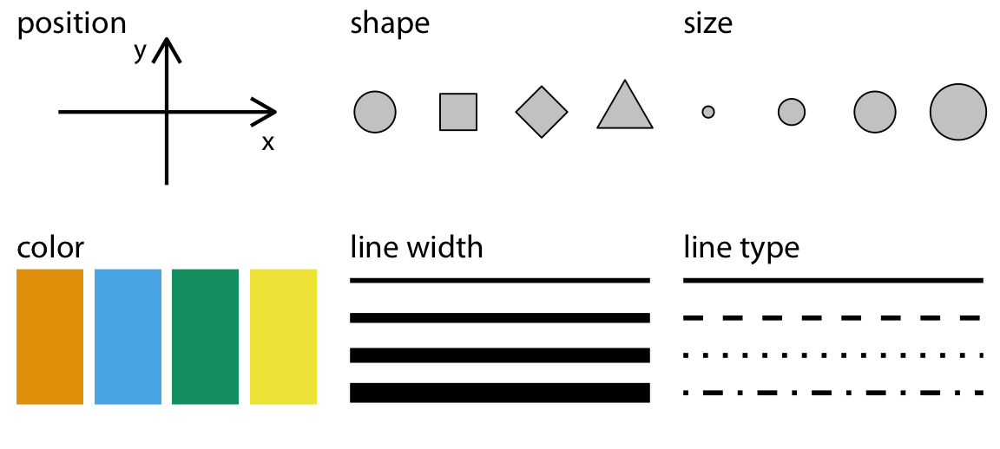
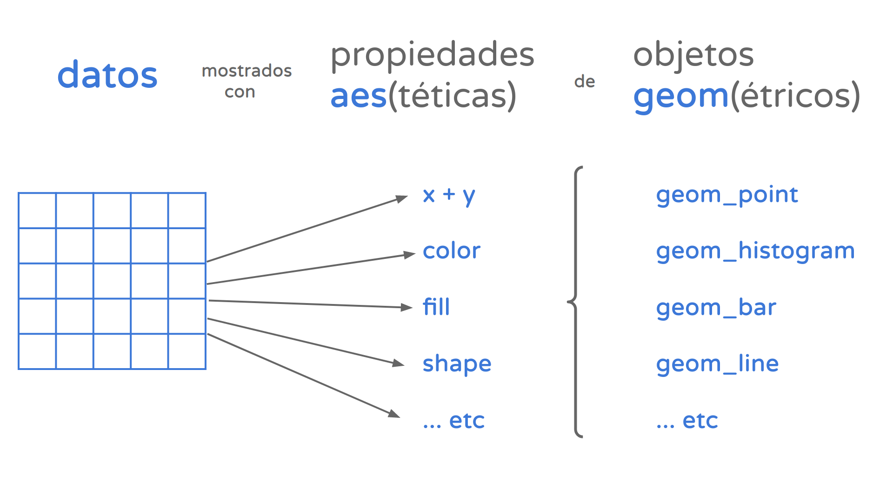
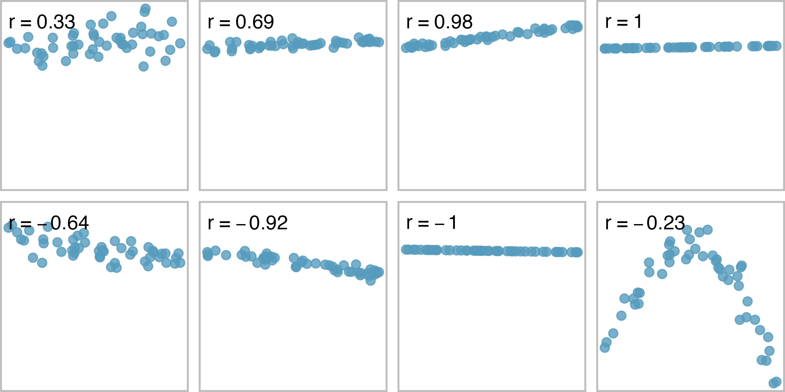

```{r}
#| label: setup
#| message: false
#| warning: false

library(tidyverse)
library(readxl)
library(ggthemes)       # temas visuales para ggplot
library(ggridges)       # densidades apiladas
library(plotly)         # gráficos interactivos
library(reldist)        # Gini ponderado
```

# Objetivos de la clase

Esta clase combina el lenguaje y las técnicas que R provee para
**visualizar** información con el análisis de la **distribución del
ingreso**. Al terminar la práctica vamos a poder:

- Entender la lógica de capas de `ggplot()` y construir un gráfico
  **capa por capa**.
- Elegir la geometría adecuada para mostrar una **variable continua**
  (histograma, kernel, ridges).
- Construir **quintiles de ingreso ponderados** y calcular la **brecha**
  entre extremos.
- Construir la **curva de Lorenz** y el **coeficiente de Gini**
  ponderado, y compararlo entre varones y mujeres.
- Descomponer el **ingreso total individual** según sus fuentes
  (laborales, políticas sociales y otros no laborales) y comparar esa
  composición entre varones y mujeres.
- Interpretar un **coeficiente de correlación** y evaluar su
  **significancia** con un test t.

# Carga de la base

Trabajamos, como en las clases anteriores, con la base individual del
1er trimestre de 2025.

```{r}
individual_25_t1 <- read.table("bases_eph/usu_individual_T125.txt",
                               sep = ";", dec = ",", header = TRUE, fill = TRUE)
```

# Visualización con `ggplot`

Una parte importante del uso de R consiste en las herramientas de
visualización que este provee. Para ello, a partir de aquí trabajaremos
sobre la librería `ggplot`, la cual forma parte del entorno `tidyverse`
y su uso se encuentra ampliamente difundido entre la comunidad de
usuarios/as de R.

Para comenzar, además de analizar la estructura de la lógica sintáctica,
trabajaremos sobre un concepto central de `ggplot`: la asignación de
**atributos estéticos** a los valores que toma una determinada variable.
Dicho de otra forma, cómo mostrar de modo perceptible a la vista la
diferencia entre valores. Generalmente lo hacemos describiendo
posiciones de un valor x y un valor y, pero también podemos definir un
tamaño, una forma, o un color.

{width="50%"}

`ggplot` tiene su sintaxis propia. La idea central es pensar los
gráficos como una **sucesión de capas**, que se construyen una a la vez.

¿Cómo funciona esto en la práctica?

- El comando `ggplot()` nos permite definir los **datos** y las
  **variables** (x, y, color, forma, etc.).

- El operador `+` nos permite incorporar nuevas capas al gráfico.

- Las sucesivas capas nos permiten definir:

  - Uno o más tipos de gráficos (de columnas, `geom_col()`; de línea,
    `geom_line()`; de puntos, `geom_point()`; boxplot,
    `geom_boxplot()`).
  - Títulos, `labs()`.
  - Estilo del gráfico, `theme()`.
  - Escalas de los ejes, `scale_y_continuous()`, `scale_x_discrete()`.
  - División en subconjuntos, `facet_wrap()`, `facet_grid()`.

`ggplot` tiene muchos comandos, y no tiene sentido saberlos de memoria:
es siempre útil reutilizar gráficos viejos y tener a mano el
[machete](https://posit.co/).

Para armar un gráfico vamos a necesitar definir al menos una
**geometría** (el recurso visual con el que vamos a mostrar la
información: líneas, puntos, barras, etc.) y al menos una **asignación
estética** (especificar cuáles variables queremos mostrar, y qué
atributo estético va a representar sus valores: el color, el tamaño, la
transparencia, etc.).

`ggplot()` implementa su propia "gramática de los gráficos". Ésta
permite expresar en forma concisa los componentes de un gráfico:

{width="50%"}

## Gráfico de puntos, capa por capa

A continuación vamos a crear un **dataframe** como insumo para realizar
un gráfico de puntos. Visualizaremos el salario promedio y la tasa de no
registro, para cada uno de los aglomerados EPH. El tamaño de los puntos
estará seteado en función de la cantidad de asalariados, y el color en
función de la región de pertenencia.

- Cargamos los diccionarios de regiones y aglomerados.
- Agrupamos por aglomerado (y región) y estimamos la tasa de no registro
  y el salario promedio.

```{r}
aglomerados <- read_excel("bases_eph/Aglomerados y Regiones EPH.xlsx")

# parámetro skip = 1, para saltear una fila
regiones <- read_excel("bases_eph/Aglomerados y Regiones EPH.xlsx",
                       sheet = "Regiones EPH", skip = 1)

salario_y_no_registro <- individual_25_t1 %>%
  filter(ESTADO == 1, CAT_OCUP == 3) %>%
  group_by(ANO4, TRIMESTRE, REGION, AGLOMERADO) %>%
  summarise(tasa_no_reg  = sum(PONDERA[PP07H == 2]) / sum(PONDERA),
            salario_prom = weighted.mean(P21, PONDIIO),
            asalariados  = sum(PONDERA),
            .groups = "drop") %>%
  left_join(aglomerados, by = "AGLOMERADO") %>%
  left_join(regiones,    by = "REGION")

salario_y_no_registro
```

::: {.callout-important appearance="simple"}
## Un ponderador para cada cosa

Fíjense que en el mismo `summarise()` conviven dos ponderadores. Para
contar **personas** (la tasa de no registro, la cantidad de asalariados)
usamos `PONDERA`. Para promediar **ingresos de la ocupación principal**
usamos `PONDIIO`, que es el ponderador que el diseño de registro define
para esa variable. No es un detalle de estilo: usar el ponderador
equivocado cambia el resultado.
:::

Este es el gráfico final al que queremos llegar:

```{r}
#| echo: false

ggplot(data = salario_y_no_registro,
       aes(x = salario_prom,
           y = tasa_no_reg,
           size = asalariados,
           color = Region)) +
  geom_point() +
  labs(title = "Salario promedio y tasa de no registro por aglomerados",
       subtitle = "31 Aglomerados. 1er Trimestre de 2025.",
       x = "Salario promedio",
       y = "Tasa de no registro") +
  theme_minimal() +
  guides(size = "none") +
  scale_y_continuous(labels = scales::percent_format(accuracy = 1)) +
  scale_x_continuous(labels = scales::number_format(big.mark = ".", decimal.mark = ","))
```

Veamos ahora el "paso a paso", o "capa a capa", de ese gráfico.

**Capa 1.** Dentro de `ggplot()` defino el dataframe que voy a utilizar
con el parámetro `data =`, y los parámetros estéticos que van a depender
de las variables de mi dataframe dentro del `aes()`. El resultado
todavía no muestra nada: R ya sabe qué ejes y qué escalas necesita, pero
no le dijimos con qué dibujar.

```{r}
capa1 <- ggplot(data = salario_y_no_registro,
                aes(x = salario_prom,
                    y = tasa_no_reg,
                    size = asalariados,
                    color = Region))

capa1
```

**Capa 2.** Defino el tipo de geometría que quiero (en este caso de
puntos, pero podría ser de columnas, líneas, densidad, etc.).

```{r}
capa2 <- capa1 +
  geom_point()

capa2
```

**Capa 3.** Con `labs()` puedo definir título, subtítulo y nombres de
los ejes.

```{r}
capa3 <- capa2 +
  labs(title = "Salario promedio y tasa de no registro por aglomerados",
       subtitle = "31 Aglomerados. 1er Trimestre de 2025.",
       x = "Salario promedio",
       y = "Tasa de no registro")

capa3
```

**Capa 4.** Los retoques finales:

- En la capa de `theme()` puedo cambiar el diseño del cuadrante donde se
  visualizan los datos. En este caso usé la función `theme_minimal()`,
  que tiene definido un tema con fondo blanco y pequeñas líneas grises
  para seguir la línea de los números que se muestran en el eje.
- En la capa de `guides()` modifico todo lo vinculado a las **leyendas**
  del gráfico. Acá la usamos para eliminar la leyenda asociada al tamaño
  de los puntos. También allí podría modificar el título de la otra
  leyenda, el tamaño de los puntos, etc.
- Las últimas dos capas, `scale_y_continuous()` y
  `scale_x_continuous()`, me permiten modificar las escalas de los
  respectivos ejes, cambiar el formato en el que aparecen los números, o
  cuántas referencias mostrar de la escala en cuestión.

```{r}
grafico_final <- capa3 +
  theme_minimal() +
  guides(size = "none") +
  scale_y_continuous(labels = scales::percent_format(accuracy = 1)) +
  scale_x_continuous(labels = scales::number_format(big.mark = ".", decimal.mark = ","))

grafico_final
```

::: {.callout-warning appearance="simple"}
## `guides(size = F)` ya no se usa

En versiones viejas de `ggplot2` la leyenda se apagaba con
`guides(size = F)`. Desde la versión 3.3.4 eso está **deprecado** y
devuelve un aviso: la forma correcta es `guides(size = "none")`. Si
retoman código propio de hace unos años, este es uno de los avisos que
se van a encontrar seguido.
:::

### Grabar un gráfico

Como cualquier otro objeto de R, un gráfico se puede guardar. `ggsave()`
toma el objeto y lo escribe en disco, en el formato que indique la
extensión del nombre del archivo.

```{r}
# ggsave(filename = "Resultados/grafico_aglomerados.png",
#        plot = grafico_final,
#        width = 8, height = 5)
```

## Visualizar una variable continua

Creamos acá un nuevo dataframe para los ejemplos que siguen:

- sólo con los casos de ingreso de la ocupación principal mayores a 0,
- con una variable categórica para el sexo.

```{r}
base_para_otros_ejemplos <- individual_25_t1 %>%
  mutate(PONDIIO = as.numeric(PONDIIO)) %>%  # Para evitar Integer Overflow
  filter(P21 > 0) %>%
  mutate(Sexo = case_when(CH04 == 1 ~ "Varón",
                          CH04 == 2 ~ "Mujer"))
```

### [Histogramas](https://ggplot2.tidyverse.org/reference/geom_histogram.html)

El histograma divide el recorrido de la variable en **bins** (por
default, 30 intervalos consecutivos) y muestra cuántas observaciones
caen en cada uno.

```{r}
ggplot(base_para_otros_ejemplos, aes(x = P21, weight = PONDIIO)) +
  geom_histogram(fill = "salmon", color = "grey25") +
  scale_x_continuous(limits = c(0, 3000000),
                     labels = scales::number_format(big.mark = ".", decimal.mark = ",")) +
  labs(title = "Distribución del ingreso de la ocupación principal",
       subtitle = "Total aglomerados EPH. 1er trimestre de 2025.",
       x = "Ingreso de la ocupación principal", y = "Casos (ponderados)") +
  theme_minimal()
```

::: {.callout-important appearance="simple"}
## `weight`, no `weights`

La estética que `ggplot2` entiende para ponderar se llama **`weight`**,
en singular. Si escriben `weights = PONDIIO` el gráfico igual se dibuja,
pero R lo trata como una estética desconocida, la ignora en silencio (o
con un aviso `Ignoring unknown aesthetics`) y el gráfico queda **sin
ponderar**. Es un error difícil de detectar, justamente porque no rompe
nada.
:::

::: {.callout-warning appearance="simple"}
## `limits =` recorta datos, no sólo la vista

`scale_x_continuous(limits = c(0, 3000000))` no hace zoom: **elimina**
las observaciones que quedan fuera del rango antes de calcular el
gráfico, y por eso avisa `Removed n rows containing non-finite values`.
Acá lo usamos a propósito (el 1% de ingresos más altos estira el eje y
aplasta todo lo demás), pero si lo que quieren es sólo acercar la mirada
sin perder casos, la alternativa es
`coord_cartesian(xlim = c(0, 3000000))`.
:::

### [Kernels](https://ggplot2.tidyverse.org/reference/geom_density.html)

La función `geom_density()` nos permite construir **kernels** de la
distribución. Es particularmente útil cuando tenemos una variable
continua, dado que los histogramas rompen esa sensación de continuidad.

```{r}
ggplot(base_para_otros_ejemplos, aes(x = P21, weight = PONDIIO)) +
  geom_density(fill = "salmon", color = "grey25") +
  scale_x_continuous(limits = c(0, 3000000),
                     labels = scales::number_format(big.mark = ".", decimal.mark = ",")) +
  labs(x = "Ingreso de la ocupación principal", y = "Densidad") +
  theme_minimal()
```

**El eje y no tiene demasiada interpretabilidad en los kernels**, porque
hace a la forma en que se construyen las distribuciones.

El parámetro `adjust`, dentro de `geom_density()`, nos permite reducir o
ampliar el rango de suavizado de la distribución. Su valor por default
es 1. Veamos qué sucede si lo seteamos en 2:

```{r}
ggplot(base_para_otros_ejemplos, aes(x = P21, weight = PONDIIO)) +
  geom_density(adjust = 2, fill = "salmon", color = "grey25") +
  scale_x_continuous(limits = c(0, 3000000),
                     labels = scales::number_format(big.mark = ".", decimal.mark = ",")) +
  labs(x = "Ingreso de la ocupación principal", y = "Densidad") +
  theme_minimal()
```

Como es esperable, la distribución del ingreso tiene "picos" en los
valores redondos, ya que la gente suele declarar un valor aproximado al
ingreso efectivo que percibe. Nadie declara ingresos de \$ 800.001. Al
suavizar la serie con un kernel eliminamos ese efecto. Si seteamos el
rango de suavizado en valores menores a 1, los picos vuelven a aparecer:

```{r}
ggplot(base_para_otros_ejemplos, aes(x = P21, weight = PONDIIO)) +
  geom_density(adjust = 0.01, fill = "salmon", color = "grey25") +
  scale_x_continuous(limits = c(0, 3000000),
                     labels = scales::number_format(big.mark = ".", decimal.mark = ",")) +
  labs(x = "Ingreso de la ocupación principal", y = "Densidad") +
  theme_minimal()
```

Ese "peine" es información sustantiva, y no ruido: es la huella del
**redondeo declarativo**. Lo vamos a volver a encontrar más abajo,
cuando armemos quintiles.

### [ggridges](https://cran.r-project.org/web/packages/ggridges/vignettes/introduction.html)

Útil para comparar la distribución de una variable continua **según
distintas categorías**: en lugar de superponer las densidades, las
apila.

```{r}
ggplot(base_para_otros_ejemplos, aes(x = P21, y = Sexo, fill = Sexo)) +
  geom_density_ridges(alpha = 0.7) +
  scale_x_continuous(limits = c(0, 3000000),
                     labels = scales::number_format(big.mark = ".", decimal.mark = ",")) +
  labs(title = "Distribución del ingreso de la ocupación principal, según sexo",
       subtitle = "Total aglomerados EPH. 1er trimestre de 2025.",
       x = "Ingreso de la ocupación principal", y = NULL) +
  guides(fill = "none") +
  theme_minimal()
```

Se ve que la distribución de las mujeres está corrida a la izquierda y
más concentrada en la parte baja. Ese desplazamiento es el que vamos a
intentar cuantificar en la segunda parte de la clase.

::: {.callout-note appearance="simple"}
## Sin ponderar

`geom_density_ridges()` no admite la estética `weight`, así que este
gráfico está construido sobre los casos muestrales. Sirve para comparar
**formas** de distribución, pero no lo usen para leer niveles
poblacionales.
:::

## Extensiones de [ggplot](https://exts.ggplot2.tidyverse.org/gallery/)

La librería `ggplot` tiene a su vez muchas otras librerías que extienden
sus potencialidades:

- [ggplotly](https://plotly.com/ggplot2/): para hacer gráficos
  interactivos.
- [gganimate](https://gganimate.com/): para hacer gráficos animados.
- [ggridges](https://cran.r-project.org/web/packages/ggridges/vignettes/introduction.html):
  para hacer gráficos de densidad faceteados.
- [ggally](https://ggobi.github.io/ggally/): para hacer varios gráficos
  juntos.
- [treemapify](https://cran.r-project.org/web/packages/treemapify/vignettes/introduction-to-treemapify.html).

# Ingresos en la EPH

## Las fuentes del ingreso total

La variable
`P47T` (ingreso total individual) suma todos los ingresos percibidos por cada individuo. Sin embargo, podemos recurrir a las variables desagregadas para **descomponer** el ingreso total en grandes bloques.

- **Laborales** (`itl`): ocupación principal (`P21`), otras ocupaciones
  (`TOT_P12`) y aguinaldo, bonificaciones y retroactivos de la ocupación
  principal (`PP08J1` a `PP08J3`).
- **Políticas sociales** (`i_polsoc`): jubilaciones y pensiones (con su
  aguinaldo y retroactivos), seguro de desempleo, AUH y otros planes,
  y becas de estudio.
- **Otros no laborales** (`i_otros_nolab`): alquileres,
  ganancias de negocios, intereses, cuotas alimentarias y otros.

::: {.callout-warning appearance="simple"}
## Bases post 4T 2024

Desde el 4to trimestre de 2024, la EPH desagrega algunos montos que antes venían en una sola variable. Por ejemplo, `V2_M` (ingreso por jubilación o pensión) ahora se presenta de forma desagregada como `V2_01_M` (contributivas), `V2_02_M` (moratoria y amas de casa) y `V2_03_M`(otras pensiones, entre ellas, la PUAM).
:::

```{r}
ingresos_fuente_reconstruyo <- individual_25_t1 %>%
  mutate(PONDII = as.numeric(PONDII)) %>%   # Para evitar Integer Overflow
  filter(P47T > 0, PONDII > 0) %>%           # Personas con ingreso total positivo
  # Reconstruimos las variables que desde 2024 4T vienen desagregadas
  mutate(V2_M  = V2_01_M + V2_02_M + V2_03_M,     # jubilaciones y pensiones
         V5_M  = V5_01_M + V5_02_M + V5_03_M,     # AUH, planes y ayudas sociales
         V11_M = V11_01_M + V11_02_M,             # becas de estudio
         V21_M = V21_01_M + V21_02_M + V21_03_M,  # aguinaldo de jubilaciones
         V22_M = V22_01_M + V22_02_M + V22_03_M)  # retroactivo de jubilaciones

ingresos_fuente <- ingresos_fuente_reconstruyo %>%
  mutate(PP08J1 = ifelse(is.na(PP08J1), yes = 0, no = PP08J1),
         PP08J2 = ifelse(is.na(PP08J2), yes = 0, no = PP08J2),
         PP08J3 = ifelse(is.na(PP08J3), yes = 0, no = PP08J3),
         itl  = TOT_P12 + P21 + PP08J1 + PP08J2 + PP08J3,
         inl  = V2_M + V3_M + V4_M + V5_M + V8_M + V9_M + V10_M + V11_M +
                V12_M + V18_M + V19_AM + V21_M + V22_M,
         i_polsoc      = V2_M + V4_M + V5_M + V11_M + V21_M + V22_M,
         i_jubila      = V2_M + V21_M + V22_M,
         i_otros_nolab = V3_M + V8_M + V9_M + V10_M + V12_M + V18_M + V19_AM,
         Sexo = case_when(CH04 == 1 ~ "Varón",
                          CH04 == 2 ~ "Mujer"))
```


Veamos, por ejemplo, para varones y mujeres, qué parte de la **masa** de
ingresos totales viene de cada fuente. Ponderamos con `PONDII`, que es
el ponderador del ingreso total individual.

```{r}
composicion_sexo <- ingresos_fuente %>%
  group_by(Sexo) %>%
  summarise(Laborales            = sum(itl * PONDII),
            `Políticas sociales` = sum(i_polsoc * PONDII),
            `Otros no laborales` = sum(i_otros_nolab * PONDII),
            .groups = "drop") %>%
  pivot_longer(cols = -Sexo, names_to = "fuente", values_to = "masa") %>%
  group_by(Sexo) %>%
  mutate(participacion = masa / sum(masa)) %>%
  ungroup() %>%
  mutate(fuente = factor(fuente, levels = c("Otros no laborales",
                                            "Políticas sociales",
                                            "Laborales")))

composicion_sexo

ggplot(composicion_sexo, aes(x = Sexo, y = participacion, fill = fuente)) +
  geom_col(width = 0.6) +
  geom_text(aes(label = scales::percent(participacion, accuracy = 1)),
            position = position_stack(vjust = 0.5),
            color = "white", size = 3.5) +
  scale_y_continuous(labels = scales::percent_format(accuracy = 1)) +
  scale_fill_manual(values = c("Laborales"            = "#45818e",
                               "Políticas sociales"   = "#CA225E",
                               "Otros no laborales"   = "grey50"),
                    breaks = c("Laborales", "Políticas sociales",
                               "Otros no laborales")) +
  coord_flip() +
  labs(title = "Composición del ingreso total individual según fuente, por sexo",
       subtitle = "Personas con ingresos. Total aglomerados EPH. 1er trimestre de 2025.",
       x = NULL, y = "% de la masa de ingreso total", fill = NULL) +
  theme_minimal() +
  theme(legend.position = "bottom")
```

En los varones, cerca del **85%** del ingreso total viene del trabajo.
En las mujeres esa proporción baja a alrededor del **68%**, y las
políticas sociales pesan más del doble (≈ 28% contra ≈ 12%). La mayor
parte de esa diferencia son **jubilaciones y pensiones** (pueden verlo
con `i_jubila`): representan el 23% del ingreso de las mujeres y el 12%
del de los varones. Ahí influyen la mayor esperanza de vida de las mujeres y
las moratorias previsionales, que permitieron jubilarse a muchas mujeres
que no tenían aportes. Los "otros no laborales" son marginales en
ambos casos.

::: {.callout-note appearance="simple"}
## En lo que sigue: `P21`

De acá en adelante nos concentramos en `P21`, el **ingreso de la
ocupación principal**, y por lo tanto en la población **ocupada**. Al
trabajar con esta variable, el ponderador correspondiente es `PONDIIO`.
:::

## Momentos de la distribución

Como vimos en la clase 2, la función `summary()` nos permite tener una
primera aproximación de las medidas de tendencia central de una variable
continua. Utilizamos **P21** (ingreso de la ocupación principal). En
este caso, nos devuelve los valores **sin considerar la ponderación**.

```{r}
summary(individual_25_t1$P21)
```

Como se puede ver acá, la no respuesta en ingresos aparece codificada
con el valor **-9**. Si observan la siguiente línea, son todos casos que
tienen su respectivo ponderador fijado en 0.

```{r}
individual_25_t1 %>%
  filter(P21 == -9) %>%   # Filtro los casos -9
  select(P21, PONDIIO) %>% # Sólo me quedo con las variables P21 y PONDIIO
  unique()                 # ¿Qué valores únicos hay?
```


## Brecha

En este ejercicio vamos a estudiar cómo se distribuye el ingreso de la
ocupación principal entre los ocupados. Queremos crear 5 quintiles de
ingreso y estudiar algunas características (tasa de feminización,
ingreso promedio, brecha entre quintil 5 y 1).

### Armado de quintiles

Dadas las características de la EPH, el armado de percentiles asociados
a variables de ingreso (de individuos o familias) requiere tener en
cuenta dos aspectos importantes:

- Debemos **perturbar aleatoriamente** la variable de ingresos en
  cuestión (dado que se acumulan muchos casos en valores puntuales: la
  gente declara ingresos redondeando lo que percibe realmente). Es el
  "peine" que vimos en el kernel con `adjust = 0.01`.
- Necesitamos utilizar una función que permita incorporar
  **ponderadores** al armado de los percentiles. Utilizaremos el paquete
  [statar](https://github.com/matthieugomez/statar).

### Funciones para perturbar una variable

Veamos la función `runif()` para *randomizar* números con una
distribución uniforme, entre un mínimo y un máximo establecidos.

```{r}
# Randomización de números basada en una distribución uniforme entre "min" y "max"
runif(n = 10, min = -0.99, max = 0.99)
```

¿Qué pasa si volvemos a correr la misma función de *aleatorización*?

```{r}
runif(n = 10, min = -0.99, max = 0.99)
```

Al volver a ejecutarla podemos obtener resultados distintos a los
previos. Para garantizar la replicabilidad del ejercicio podemos
utilizar la función `set.seed()`. Esta función nos permite, a partir de
especificarle un número cualquiera, garantizar los mismos resultados
cada vez que ejecutemos luego una función que realiza un procedimiento
aleatorio.

```{r}
set.seed(9999) # Semilla
runif(10, min = 0.01, max = 0.99)

set.seed(9999) # Semilla
runif(10, min = 0.01, max = 0.99)
```

Para continuar con el ejercicio, lo que hacemos es:

- Transformar en numérica la variable `PONDIIO` (la variable se carga
  como *integer*, y necesita ser numérica para evitar un error llamado
  *integer overflow*).
- Setear la semilla antes del pedazo de código en el cual vamos a
  sumarle a la variable **P21** una variable de números aleatorios con
  distribución uniforme. La variable que se suma a P21 debe tener la
  misma longitud que aquella, lo cual podemos lograr especificando
  `nrow(.)` dentro de nuestra estructura de procesamiento sucesivo.
- Luego, a partir de la variable perturbada `P21_p`, podemos crear los
  quintiles con la función `xtile()`, que corresponde al paquete
  **statar**.
- Una vez que tenemos una base con los quintiles, podemos agrupar por
  dicha variable y generar todos los indicadores que nos resulten útiles
  para analizar.

```{r}
set.seed(9999) # Semilla

base_con_quintiles <- individual_25_t1 %>%
  mutate(PONDIIO = as.numeric(PONDIIO)) %>% # Para evitar Integer Overflow
  filter(ESTADO == 1, P21 > 0) %>%
  mutate(P21_p = P21 + runif(nrow(.),
                             min = -0.99,
                             max = 0.99)) %>%
  mutate(quintil = statar::xtile(x = P21_p,
                                 n = 5,
                                 wt = PONDIIO))
```

::: {.callout-important appearance="simple"}
## El orden de los pasos no es indistinto

Primero filtramos el universo (**ocupados con ingreso positivo**) y
recién después construimos los quintiles. Si lo hiciéramos al revés, los
cortes estarían calculados sobre una población distinta —incluyendo
desocupados e inactivos con ingreso 0— y el "quintil 1" no significaría
lo mismo. Los percentiles siempre se definen **sobre la población que se
quiere describir**.
:::

Con la variable de quintil ya creada, agrupamos y calculamos los indicadores:

```{r}
resultado <- base_con_quintiles %>%
  group_by(quintil) %>%
  summarise(casos             = n(),
            casos_pondera     = sum(PONDIIO),
            tasa_feminizacion = sum(PONDIIO[CH04 == 2]) / sum(PONDIIO),
            ingreso_prom      = weighted.mean(x = P21, w = PONDIIO),
            masa_ingresos     = sum(P21 * PONDIIO),
            .groups = "drop") %>%
  mutate(part_masa = masa_ingresos / sum(masa_ingresos))

resultado
```

Cada quintil reúne aproximadamente el 20% de la población (columna
`casos_pondera`), pero **no** el 20% de los casos muestrales ni, mucho
menos, el 20% de la masa de ingresos.

### El cálculo de la brecha

La **brecha de ingresos** es simplemente el cociente entre el ingreso
promedio del quintil más alto y el del quintil más bajo. Nos dice
**cuántas veces** el ingreso medio del quintil 5 contiene al del quintil
1.

```{r}
brecha <- resultado %>%
  summarise(ingreso_q1 = ingreso_prom[quintil == 1],
            ingreso_q5 = ingreso_prom[quintil == 5],
            brecha_5_1 = ingreso_q5 / ingreso_q1)

brecha
```

El ingreso medio del quintil más rico es alrededor de **11 veces** el
del quintil más pobre. Dicho de otro modo, y mirando la columna
`part_masa`: el 20% de ocupados de menores ingresos se queda con cerca
del **4%** de la masa total de ingresos laborales, mientras que el 20%
más rico concentra casi el **47%**.

::: {.callout-tip appearance="simple"}
## La brecha depende de dónde cortemos

La brecha 5/1 usa el promedio de cada quintil, es decir, de grupos que
reúnen al 20% de la población. Si en lugar de quintiles usáramos
deciles, la brecha 10/1 daría bastante más alta, porque los extremos
serían más extremos. **No hay una única brecha**: siempre hay que
aclarar entre qué grupos se calcula.
:::

También podemos usar la tabla para leer la **composición** de cada
quintil. La tasa de feminización cae de forma sostenida a medida que
subimos en la escala de ingresos: las mujeres son alrededor del 62% de
los ocupados del quintil 1 y apenas el 31% del quintil 5.

```{r}
ggplot(resultado, aes(x = factor(quintil), y = tasa_feminizacion)) +
  geom_col(fill = "steelblue") +
  geom_hline(yintercept = 0.5, linetype = "dashed", color = "grey40") +
  scale_y_continuous(labels = scales::percent_format(accuracy = 1)) +
  labs(title = "Tasa de feminización según quintil de ingreso de la ocupación principal",
       subtitle = "Ocupados con ingresos. Total aglomerados EPH. 1er trimestre de 2025.",
       x = "Quintil de ingreso", y = "% de mujeres") +
  theme_minimal()
```

## Gini

La brecha 5/1 mira **sólo los dos extremos** y descarta todo lo que pasa
en el medio. El coeficiente de Gini, en cambio, resume en un único
número la desigualdad de **toda** la distribución.

### La curva de Lorenz

La **curva de Lorenz** ordena a la población de menor a mayor ingreso y
muestra, para cada porcentaje acumulado de población ($p$), qué
porcentaje acumulado del ingreso total concentra ($L$). La curva sirve
para ver cuanto se aleja la distribución real de una hipotética
distribución de **perfecta igualdad** reflejada en la **diagonal** de
45° (mediante la cual el 20% más pobre concentraría el 20% del ingreso,
el 40% tendría el 40%, etc.). Cuanto más desigual es la distribución,
más se hunde la curva por debajo de esa diagonal.

Filtremos a los ocupados con ingresos positivos y comparemos la
distribución de varones y mujeres. No importa aquí tanto el código, sino
la intuición.

```{r}
ocupados_con_ingreso <- individual_25_t1 %>%
  mutate(PONDIIO = as.numeric(PONDIIO)) %>%
  filter(ESTADO == 1, P21 > 0) %>%
  mutate(Sexo = case_when(CH04 == 1 ~ "Varón",
                          CH04 == 2 ~ "Mujer"))

lorenz <- ocupados_con_ingreso %>%
  group_by(Sexo) %>%
  arrange(P21, .by_group = TRUE) %>%
  mutate(p = cumsum(PONDIIO) / sum(PONDIIO),
         L = cumsum(P21 * PONDIIO) / sum(P21 * PONDIIO)) %>%
  ungroup() %>%
  select(Sexo, p, L)

ggplot(lorenz, aes(x = p, y = L, color = Sexo)) +
  geom_abline(slope = 1, intercept = 0, linetype = "dashed", color = "grey50") +
  geom_line(linewidth = 1) +
  scale_x_continuous(labels = scales::percent_format(accuracy = 1)) +
  scale_y_continuous(labels = scales::percent_format(accuracy = 1)) +
  labs(title = "Curva de Lorenz del ingreso de la ocupación principal, según sexo",
       subtitle = "Ocupados con ingresos. Total aglomerados EPH. 1er trimestre de 2025.",
       x = "% acumulado de ocupados", y = "% acumulado del ingreso",
       color = NULL) +
  coord_equal() +
  theme_minimal()
```

La línea punteada es la igualdad perfecta. La curva de las mujeres corre
por debajo de la de los varones en casi todo el recorrido (podría
perfectamente ocurrir que se crucen)

### De la curva de Lorenz al Gini

El **Gini** es la proporción que representa el área *entre la diagonal y
la curva* sobre el *área total bajo la diagonal*. De esta forma, en caso
de igualdad perfecta el Gini sería igual a **0**. Cuanto más se acerca a
**1** refleja mayor desigualdad en la distribución de la variable.

Para calcularlo un gini con ponderadores, podemos recurrir a la función
**gini** del paquete **reldist**

Calculemos el Gini **por separado** para varones y mujeres, junto con el
ingreso medio de cada grupo:

```{r}
gini_por_sexo <- ocupados_con_ingreso %>%
  group_by(Sexo) %>%
  summarise(casos          = n(),
            poblacion      = sum(PONDIIO),
            ingreso_medio  = weighted.mean(P21, PONDIIO),
            gini           = reldist::gini(P21, PONDIIO),
            .groups = "drop")

gini_por_sexo
```

Dos resultados que conviene leer juntos:

- El ingreso medio de las mujeres es cerca de un **28% menor** que el de
  los varones. Esa es la **brecha de ingresos (no condicionada) por
  sexo**: una diferencia de **nivel** entre los dos grupos.
- El Gini de las mujeres (≈ 0,44) es **más alto** que el de los varones
  (≈ 0,40). Es decir, además de ganar menos en promedio, las mujeres
  constituyen un grupo **internamente más desigual**.

::: {.callout-important appearance="simple"}
## Nivel y dispersión son cosas distintas

Un Gini más alto **no** significa "más pobre", y un Gini más bajo no
significa "mejor". El Gini es una medida de **dispersión relativa**: no
cambia si multiplicamos todos los ingresos por dos. Dos grupos pueden
tener el mismo Gini con ingresos medios muy distintos, y viceversa.
:::

## Correlación

Hasta acá venimos estudiando la distribución de **una** variable
continua. Cuando queremos estudiar la relación entre **dos** variables
continuas, una primera herramienta es el **coeficiente de correlación de
Pearson**, que mide la fuerza y el sentido de la asociación **lineal**
entre ambas. Puede tomar valores entre -1 (relación negativa perfecta) y
1 (relación positiva perfecta), pasando por 0 (si no existe una relación
lineal). Su valor no tiene unidades y no es sensible a transformaciones
lineales en las variables.



La correlación lineal surge de la siguiente fórmula:

$$\rho_{xy} \equiv r_{xy} = \frac{\sum_{i=1}^n (x_{i} - \overline{x}_{i})(y_{i} - \overline{y}_{i})}{\sqrt{\sum_{i=1}^n (x_{i} - \overline{x}_{i})^2} \sqrt{\sum_{i=1}^n (y_{i} - \overline{y}_{i})^2}}=\frac{\sum_{i=1}^n (x_{i} - \overline{x}_{i})(y_{i} - \overline{y}_{i})}{(n - 1)s_x s_y} =\frac{cov(x,y)}{s_x s_y} $$

### Exploración visual con `ggpairs()`

Antes de calcular coeficientes conviene **mirar** las relaciones.
Trabajamos con tres variables continuas de la EPH:

- Ingreso de la ocupación principal (filtramos ingresos positivos)

- Edad (filtramos a 14-65, para contemplar edades laborales)

- Horas trabajadas (casos positivos y que no sean 999, no respuesta)

```{r}
ocupados_edad <- ocupados_con_ingreso %>%
  filter(P21 >0,
         T_VI >=0,
         CH06 %in% c(14:65),
         PP3E_TOT >0 & PP3E_TOT != 999,
         )  
```

Si tenemos relativamente pocas variables, podemos usar `ggpairs()` (del
paquete **GGally**) para ver de una sola vez todas las relaciones entre
ellas: en la diagonal la distribución de cada variable, debajo los
diagramas de dispersión y arriba los coeficientes de correlación. Una
funcionalidad útil es que nos permite calcular la correlación
**controlando por una variable categórica** (en este caso, el sexo), lo
que nos acerca a la idea de una correlación parcial.

```{r,warning=FALSE,message=F}
ocup_edad_sexo<- ocupados_edad %>% 
  select(Sexo,P21,CH06,PP3E_TOT)

GGally::ggpairs(ocup_edad_sexo,
        ggplot2::aes(
          color = Sexo,
          fill = Sexo,
          alpha = 0.8
        ),
        labeller = label_wrap_gen(width = 5)) +
  theme_minimal() +
  scale_color_manual(values = c("#45818e", "#CA225E")) +
  scale_fill_manual(values = c("#45818e", "#CA225E")) +
  theme(strip.text.x = element_text(size = 10),
        strip.text.y = element_text(size = 10))
```

### Matriz de correlación

La **matriz de correlación** nos permite resumir en una tabla las
correlaciones entre todos los pares de variables. Sumamos el ingreso
total no laboral (`T_VI`):

```{r}
corr <- ocupados_edad %>% 
  select(P21,CH06,PP3E_TOT,T_VI) %>% 
  # Calculamos la matriz de correlaciones
  cor()

corr
```

Si tenemos muchas variables y queremos ver mejor las relaciones
gráficamente, podemos recurrir a la librería *corrplot*.

```{r}
library(corrplot)
```

```{r}
#Graficamos con nuestro propio espectro de colores
corr %>% 
  corrplot(tl.col = "black", method = "square")
```

La matriz muestra que la asociación más fuerte es entre el ingreso de
la ocupación principal y las horas trabajadas. Las demás correlaciones
son bastante más débiles.

### ¿Es significativa la correlación?

El coeficiente que calculamos describe **la muestra**. La pregunta
inferencial es si en la **población** existe alguna asociación lineal, o
si el valor observado podría deberse al azar del muestreo. Para eso se
usa un **test t**, cuya hipótesis nula es que la correlación poblacional
es cero ($H_0: \rho = 0$). El estadístico se calcula a partir de $r$ y
del tamaño de la muestra:

$$t = \frac{r\sqrt{n-2}}{\sqrt{1-r^2}} \qquad \text{con } n-2 \text{ grados de libertad}$$

En R lo hace la función `cor.test()`. Probemos con ingreso y horas
trabajadas:

```{r}
test_horas <- cor.test(ocupados_edad$P21, ocupados_edad$PP3E_TOT,
                       method = "pearson")

test_horas
```

La salida informa el valor de $r$, el estadístico $t$, el p-valor y un
intervalo de confianza al 95%. Acá $r$ =
`r round(test_horas$estimate, 2)` y el p-valor es prácticamente cero, así
que rechazamos $H_0$. Hay asociación lineal positiva entre horas e
ingreso, y su intervalo de confianza
(`r round(test_horas$conf.int[1], 2)` a `r round(test_horas$conf.int[2], 2)`)
es angosto.

::: {.callout-note appearance="simple"}
## Sin ponderar y sin diseño muestral

`cor.test()` trata a los casos como una muestra aleatoria simple y no
admite ponderadores. La EPH tiene un diseño por conglomerados, así que
los p-valores que devuelve son algo optimistas. Para una primera
exploración alcanza, pero conviene tenerlo presente.
:::

# Ejercicios

## Para practicar

- **Deciles y brecha 10/1.** Repetir el armado de quintiles de la clase
  pero con `n = 10`. Calcular la brecha entre el ingreso medio del decil
  10 y el del decil 1 y compararla con la brecha 5/1. ¿Cuánto cambia?\
  Pista: no se olviden de `set.seed()` y de perturbar `P21`.

- **Gini por región.** Calcular el Gini ponderado de `P21` para los
  ocupados con ingresos de cada región (variable `REGION`, unida con el
  diccionario de regiones). Graficarlo con `geom_col()` ordenando las
  barras de mayor a menor. ¿Qué región es más desigual?\
  Pista: `reldist::gini()` dentro de un `summarise()` agrupado, y
  `reorder()` en el eje x.

- **Correlación por sexo.** Con la base `ocupados_edad`, correr
  `cor.test()` entre ingreso de la ocupación principal y horas
  trabajadas, por separado para varones y para mujeres. ¿En cuál de los
  dos grupos la asociación es más fuerte? ¿Los intervalos de confianza
  se superponen?

## De tarea

- **Composición del ingreso por quintil.** Usando las variables de
  fuentes de ingreso construidas en la clase (`itl`, `i_polsoc`,
  `i_otros_nolab`), armar quintiles del **ingreso total individual**
  (`P47T`, con su ponderador `PONDII`) y graficar qué parte del ingreso
  de cada quintil proviene de cada fuente. ¿Dónde pesan más las
  políticas sociales?

- **Lorenz con ingreso total.** Repetir la curva de Lorenz y el Gini por
  sexo, pero con `P47T` en lugar de `P21` (sobre todas las personas con
  ingreso total positivo). ¿La distancia entre varones y mujeres se
  achica o se agranda respecto de la que vimos con el ingreso laboral?

## Bibliografía {.unnumbered}

```{=html}
<div id="refs" class="references csl-bib-body hanging-indent">

  <div id="ref-wickham2025" class="csl-entry">
    Wickham, H., &amp; Grolemund, G. (2023). <i>R for Data Science (2nd ed)</i>. O'Reilly Media.
  </div>

  <div id="ref-tidyverse2023" class="csl-entry">
    Tidyverse. (2023, April). <i>Base vs. magrittr pipe</i>. Recuperado de <a href="https://www.tidyverse.org/blog/2023/04/base-vs-magrittr-pipe/">https://www.tidyverse.org/blog/2023/04/base-vs-magrittr-pipe/</a>
  </div>

  <div id="ref-dataviz" class="csl-entry">
    DataViz Inspiration. (n.d.). RetrievedRecuperado de <a href="https://www.dataviz-inspiration.com/">https://www.dataviz-inspiration.com/</a>
  </div>

</div>
```
