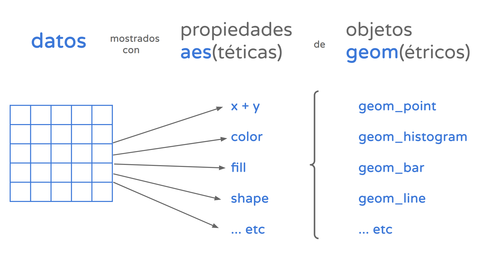

```{r}
#| label: setup
#| message: false
#| warning: false

library(tidyverse)
library(readxl)
library(ggthemes)       # temas visuales para ggplot
library(ggridges)       # densidades apiladas
library(plotly)         # gráficos interactivos
```

# Objetivos de la clase

Esta clase combina el lenguaje y las técnicas que R provee para **visualizar** información con el
análisis de la **distribución del ingreso**. Al terminar la práctica vamos a poder:

- Entender la lógica de capas de `ggplot()` y construir un gráfico **capa por capa**.
- Elegir la geometría adecuada para mostrar una **variable continua** (histograma, kernel, ridges).
- Construir **quintiles de ingreso ponderados** y calcular la **brecha** entre extremos.
- Construir la **curva de Lorenz** y el **coeficiente de Gini** ponderado, y compararlo entre
  varones y mujeres.
- Interpretar un **coeficiente de correlación** y reconocer cuándo una relación **no es lineal**,
  ajustándola con `geom_smooth()`.

# Carga de la base

Trabajamos, como en las clases anteriores, con la base individual del 1er trimestre de 2025.

```{r}
individual_25_t1 <- read.table("bases_eph/usu_individual_T125.txt",
                               sep = ";", dec = ",", header = TRUE, fill = TRUE)
```

# Visualización con `ggplot`

Una parte importante del uso de R consiste en las herramientas de visualización que este provee.
Para ello, a partir de aquí trabajaremos sobre la librería `ggplot`, la cual forma parte del
entorno `tidyverse` y su uso se encuentra ampliamente difundido entre la comunidad de usuarios/as
de R.

Para comenzar, además de analizar la estructura de la lógica sintáctica, trabajaremos sobre un
concepto central de `ggplot`: la asignación de **atributos estéticos** a los valores que toma una
determinada variable. Dicho de otra forma, cómo mostrar de modo perceptible a la vista la
diferencia entre valores. Generalmente lo hacemos describiendo posiciones de un valor x y un valor
y, pero también podemos definir un tamaño, una forma, o un color.

{width="50%"}

`ggplot` tiene su sintaxis propia. La idea central es pensar los gráficos como una **sucesión de
capas**, que se construyen una a la vez.

¿Cómo funciona esto en la práctica?

- El comando `ggplot()` nos permite definir los **datos** y las **variables** (x, y, color, forma, etc.).

- El operador `+` nos permite incorporar nuevas capas al gráfico.

- Las sucesivas capas nos permiten definir:

  - Uno o más tipos de gráficos (de columnas, `geom_col()`; de línea, `geom_line()`; de puntos,
    `geom_point()`; boxplot, `geom_boxplot()`).
  - Títulos, `labs()`.
  - Estilo del gráfico, `theme()`.
  - Escalas de los ejes, `scale_y_continuous()`, `scale_x_discrete()`.
  - División en subconjuntos, `facet_wrap()`, `facet_grid()`.

`ggplot` tiene muchos comandos, y no tiene sentido saberlos de memoria: es siempre útil reutilizar
gráficos viejos y tener a mano el [machete](https://posit.co/).

Para armar un gráfico vamos a necesitar definir al menos una **geometría** (el recurso visual con
el que vamos a mostrar la información: líneas, puntos, barras, etc.) y al menos una **asignación
estética** (especificar cuáles variables queremos mostrar, y qué atributo estético va a representar
sus valores: el color, el tamaño, la transparencia, etc.).

`ggplot()` implementa su propia "gramática de los gráficos". Ésta permite expresar en forma concisa
los componentes de un gráfico:

{width="50%"}

## Gráfico de puntos, capa por capa

A continuación vamos a crear un **dataframe** como insumo para realizar un gráfico de puntos.
Visualizaremos el salario promedio y la tasa de no registro, para cada uno de los aglomerados EPH.
El tamaño de los puntos estará seteado en función de la cantidad de asalariados, y el color en
función de la región de pertenencia.

- Cargamos los diccionarios de regiones y aglomerados.
- Agrupamos por aglomerado (y región) y estimamos la tasa de no registro y el salario promedio.

```{r}
aglomerados <- read_excel("bases_eph/Aglomerados y Regiones EPH.xlsx")

# parámetro skip = 1, para saltear una fila
regiones <- read_excel("bases_eph/Aglomerados y Regiones EPH.xlsx",
                       sheet = "Regiones EPH", skip = 1)

salario_y_no_registro <- individual_25_t1 %>%
  filter(ESTADO == 1, CAT_OCUP == 3) %>%
  group_by(ANO4, TRIMESTRE, REGION, AGLOMERADO) %>%
  summarise(tasa_no_reg  = sum(PONDERA[PP07H == 2]) / sum(PONDERA),
            salario_prom = weighted.mean(P21, PONDIIO),
            asalariados  = sum(PONDERA),
            .groups = "drop") %>%
  left_join(aglomerados, by = "AGLOMERADO") %>%
  left_join(regiones,    by = "REGION")

salario_y_no_registro
```

::: {.callout-important appearance="simple"}
## Un ponderador para cada cosa

Fíjense que en el mismo `summarise()` conviven dos ponderadores. Para contar **personas** (la tasa
de no registro, la cantidad de asalariados) usamos `PONDERA`. Para promediar **ingresos de la
ocupación principal** usamos `PONDIIO`, que es el ponderador que el diseño de registro define para
esa variable. No es un detalle de estilo: usar el ponderador equivocado cambia el resultado.
:::

Este es el gráfico final al que queremos llegar:

```{r}
#| echo: false

ggplot(data = salario_y_no_registro,
       aes(x = salario_prom,
           y = tasa_no_reg,
           size = asalariados,
           color = Region)) +
  geom_point() +
  labs(title = "Salario promedio y tasa de no registro por aglomerados",
       subtitle = "31 Aglomerados. 1er Trimestre de 2025.",
       x = "Salario promedio",
       y = "Tasa de no registro") +
  theme_minimal() +
  guides(size = "none") +
  scale_y_continuous(labels = scales::percent_format(accuracy = 1)) +
  scale_x_continuous(labels = scales::number_format(big.mark = ".", decimal.mark = ","))
```

Veamos ahora el "paso a paso", o "capa a capa", de ese gráfico.

**Capa 1.** Dentro de `ggplot()` defino el dataframe que voy a utilizar con el parámetro `data =`,
y los parámetros estéticos que van a depender de las variables de mi dataframe dentro del `aes()`.
El resultado todavía no muestra nada: R ya sabe qué ejes y qué escalas necesita, pero no le dijimos
con qué dibujar.

```{r}
capa1 <- ggplot(data = salario_y_no_registro,
                aes(x = salario_prom,
                    y = tasa_no_reg,
                    size = asalariados,
                    color = Region))

capa1
```

**Capa 2.** Defino el tipo de geometría que quiero (en este caso de puntos, pero podría ser de
columnas, líneas, densidad, etc.).

```{r}
capa2 <- capa1 +
  geom_point()

capa2
```

**Capa 3.** Con `labs()` puedo definir título, subtítulo y nombres de los ejes.

```{r}
capa3 <- capa2 +
  labs(title = "Salario promedio y tasa de no registro por aglomerados",
       subtitle = "31 Aglomerados. 1er Trimestre de 2025.",
       x = "Salario promedio",
       y = "Tasa de no registro")

capa3
```

**Capa 4.** Los retoques finales:

- En la capa de `theme()` puedo cambiar el diseño del cuadrante donde se visualizan los datos. En
  este caso usé la función `theme_minimal()`, que tiene definido un tema con fondo blanco y
  pequeñas líneas grises para seguir la línea de los números que se muestran en el eje.
- En la capa de `guides()` modifico todo lo vinculado a las **leyendas** del gráfico. Acá la usamos
  para eliminar la leyenda asociada al tamaño de los puntos. También allí podría modificar el
  título de la otra leyenda, el tamaño de los puntos, etc.
- Las últimas dos capas, `scale_y_continuous()` y `scale_x_continuous()`, me permiten modificar las
  escalas de los respectivos ejes, cambiar el formato en el que aparecen los números, o cuántas
  referencias mostrar de la escala en cuestión.

```{r}
grafico_final <- capa3 +
  theme_minimal() +
  guides(size = "none") +
  scale_y_continuous(labels = scales::percent_format(accuracy = 1)) +
  scale_x_continuous(labels = scales::number_format(big.mark = ".", decimal.mark = ","))

grafico_final
```

::: {.callout-warning appearance="simple"}
## `guides(size = F)` ya no se usa

En versiones viejas de `ggplot2` la leyenda se apagaba con `guides(size = F)`. Desde la versión
3.3.4 eso está **deprecado** y devuelve un aviso: la forma correcta es `guides(size = "none")`. Si
retoman código propio de hace unos años, este es uno de los avisos que se van a encontrar seguido.
:::

### Grabar un gráfico

Como cualquier otro objeto de R, un gráfico se puede guardar. `ggsave()` toma el objeto y lo
escribe en disco, en el formato que indique la extensión del nombre del archivo.

```{r}
# ggsave(filename = "Resultados/grafico_aglomerados.png",
#        plot = grafico_final,
#        width = 8, height = 5)
```

## Visualizar una variable continua

Creamos acá un nuevo dataframe para los ejemplos que siguen:

- sólo con los casos de ingreso de la ocupación principal mayores a 0,
- con una variable categórica para el sexo.

```{r}
base_para_otros_ejemplos <- individual_25_t1 %>%
  mutate(PONDIIO = as.numeric(PONDIIO)) %>%  # Para evitar Integer Overflow
  filter(P21 > 0) %>%
  mutate(Sexo = case_when(CH04 == 1 ~ "Varón",
                          CH04 == 2 ~ "Mujer"))
```

### [Histogramas](https://ggplot2.tidyverse.org/reference/geom_histogram.html)

El histograma divide el recorrido de la variable en **bins** (por default, 30 intervalos
consecutivos) y muestra cuántas observaciones caen en cada uno.

```{r}
ggplot(base_para_otros_ejemplos, aes(x = P21, weight = PONDIIO)) +
  geom_histogram(fill = "salmon", color = "grey25") +
  scale_x_continuous(limits = c(0, 3000000),
                     labels = scales::number_format(big.mark = ".", decimal.mark = ",")) +
  labs(title = "Distribución del ingreso de la ocupación principal",
       subtitle = "Total aglomerados EPH. 1er trimestre de 2025.",
       x = "Ingreso de la ocupación principal", y = "Casos (ponderados)") +
  theme_minimal()
```

::: {.callout-important appearance="simple"}
## `weight`, no `weights`

La estética que `ggplot2` entiende para ponderar se llama **`weight`**, en singular. Si escriben
`weights = PONDIIO` el gráfico igual se dibuja, pero R lo trata como una estética desconocida, la
ignora en silencio (o con un aviso `Ignoring unknown aesthetics`) y el gráfico queda **sin
ponderar**. Es un error difícil de detectar, justamente porque no rompe nada.
:::

::: {.callout-warning appearance="simple"}
## `limits =` recorta datos, no sólo la vista

`scale_x_continuous(limits = c(0, 3000000))` no hace zoom: **elimina** las observaciones que quedan
fuera del rango antes de calcular el gráfico, y por eso avisa `Removed n rows containing
non-finite values`. Acá lo usamos a propósito (el 1% de ingresos más altos estira el eje y aplasta
todo lo demás), pero si lo que quieren es sólo acercar la mirada sin perder casos, la alternativa
es `coord_cartesian(xlim = c(0, 3000000))`.
:::

### [Kernels](https://ggplot2.tidyverse.org/reference/geom_density.html)

La función `geom_density()` nos permite construir **kernels** de la distribución. Es
particularmente útil cuando tenemos una variable continua, dado que los histogramas rompen esa
sensación de continuidad.

```{r}
ggplot(base_para_otros_ejemplos, aes(x = P21, weight = PONDIIO)) +
  geom_density(fill = "salmon", color = "grey25") +
  scale_x_continuous(limits = c(0, 3000000),
                     labels = scales::number_format(big.mark = ".", decimal.mark = ",")) +
  labs(x = "Ingreso de la ocupación principal", y = "Densidad") +
  theme_minimal()
```

**El eje y no tiene demasiada interpretabilidad en los kernels**, porque hace a la forma en que se
construyen las distribuciones.

El parámetro `adjust`, dentro de `geom_density()`, nos permite reducir o ampliar el rango de
suavizado de la distribución. Su valor por default es 1. Veamos qué sucede si lo seteamos en 2:

```{r}
ggplot(base_para_otros_ejemplos, aes(x = P21, weight = PONDIIO)) +
  geom_density(adjust = 2, fill = "salmon", color = "grey25") +
  scale_x_continuous(limits = c(0, 3000000),
                     labels = scales::number_format(big.mark = ".", decimal.mark = ",")) +
  labs(x = "Ingreso de la ocupación principal", y = "Densidad") +
  theme_minimal()
```

Como es esperable, la distribución del ingreso tiene "picos" en los valores redondos, ya que la
gente suele declarar un valor aproximado al ingreso efectivo que percibe. Nadie declara ingresos de
$ 800.001. Al suavizar la serie con un kernel eliminamos ese efecto. Si seteamos el rango de
suavizado en valores menores a 1, los picos vuelven a aparecer:

```{r}
ggplot(base_para_otros_ejemplos, aes(x = P21, weight = PONDIIO)) +
  geom_density(adjust = 0.01, fill = "salmon", color = "grey25") +
  scale_x_continuous(limits = c(0, 3000000),
                     labels = scales::number_format(big.mark = ".", decimal.mark = ",")) +
  labs(x = "Ingreso de la ocupación principal", y = "Densidad") +
  theme_minimal()
```

Ese "peine" es información sustantiva, y no ruido: es la huella del **redondeo declarativo**. Lo
vamos a volver a encontrar más abajo, cuando armemos quintiles.

### [ggridges](https://cran.r-project.org/web/packages/ggridges/vignettes/introduction.html)

Útil para comparar la distribución de una variable continua **según distintas categorías**: en
lugar de superponer las densidades, las apila.

```{r}
ggplot(base_para_otros_ejemplos, aes(x = P21, y = Sexo, fill = Sexo)) +
  geom_density_ridges(alpha = 0.7) +
  scale_x_continuous(limits = c(0, 3000000),
                     labels = scales::number_format(big.mark = ".", decimal.mark = ",")) +
  labs(title = "Distribución del ingreso de la ocupación principal, según sexo",
       subtitle = "Total aglomerados EPH. 1er trimestre de 2025.",
       x = "Ingreso de la ocupación principal", y = NULL) +
  guides(fill = "none") +
  theme_minimal()
```

Se ve que la distribución de las mujeres está corrida a la izquierda y más concentrada en la parte
baja. Ese desplazamiento es el que vamos a intentar cuantificar en la segunda parte de la clase.

::: {.callout-note appearance="simple"}
## Sin ponderar

`geom_density_ridges()` no admite la estética `weight`, así que este gráfico está construido sobre
los casos muestrales. Sirve para comparar **formas** de distribución, pero no lo usen para leer
niveles poblacionales.
:::

## Extensiones de [ggplot](https://exts.ggplot2.tidyverse.org/gallery/)

La librería `ggplot` tiene a su vez muchas otras librerías que extienden sus potencialidades:

- [ggplotly](https://plotly.com/ggplot2/): para hacer gráficos interactivos.
- [gganimate](https://gganimate.com/): para hacer gráficos animados.
- [ggridges](https://cran.r-project.org/web/packages/ggridges/vignettes/introduction.html): para hacer gráficos de densidad faceteados.
- [ggally](https://ggobi.github.io/ggally/): para hacer varios gráficos juntos.
- [treemapify](https://cran.r-project.org/web/packages/treemapify/vignettes/introduction-to-treemapify.html).

# Ingresos en la EPH

## Momentos de una distribución

Como vimos en la clase 2, la función `summary()` nos permite tener una primera aproximación de las
medidas de tendencia central de una variable continua. Utilizamos **P21** (ingreso de la ocupación
principal). En este caso, nos devuelve los valores **sin considerar la ponderación**.

```{r}
summary(individual_25_t1$P21)
```

Como se puede ver acá, la no respuesta en ingresos aparece codificada con el valor **-9**. Si
observan la siguiente línea, son todos casos que tienen su respectivo ponderador fijado en 0.

```{r}
individual_25_t1 %>%
  filter(P21 == -9) %>%   # Filtro los casos -9
  select(P21, PONDIIO) %>% # Sólo me quedo con las variables P21 y PONDIIO
  unique()                 # ¿Qué valores únicos hay?
```

::: {.callout-important appearance="simple"}
## Aviso

Es muy importante, en función de la variable utilizada, trabajar con el **ponderador especificado
por el diseño de registro**. Para las variables de ingreso individual, ese ponderador es `PONDIIO`
(y `PONDII` para el ingreso total individual). El INDEC le asigna ponderador 0 a los casos de no
respuesta, de modo que cualquier estimación ponderada los excluye automáticamente. Si en cambio
usáramos `PONDERA`, los `-9` entrarían al promedio como si fueran ingresos negativos.
:::

## Brecha de ingresos

En este ejercicio vamos a estudiar cómo se distribuye el ingreso de la ocupación principal entre
los ocupados. Queremos crear 5 quintiles de ingreso y estudiar algunas características (tasa de
feminización, ingreso promedio, brecha entre quintil 5 y 1).

### Armado de quintiles

Dadas las características de la EPH, el armado de percentiles asociados a variables de ingreso (de
individuos o familias) requiere tener en cuenta dos aspectos importantes:

- Debemos **perturbar aleatoriamente** la variable de ingresos en cuestión (dado que se acumulan
  muchos casos en valores puntuales: la gente declara ingresos redondeando lo que percibe
  realmente). Es el "peine" que vimos en el kernel con `adjust = 0.01`.
- Necesitamos utilizar una función que permita incorporar **ponderadores** al armado de los
  percentiles. Utilizaremos el paquete [statar](https://github.com/matthieugomez/statar).

::: {.callout-note appearance="simple"}
## `statar` no viene con el `00_setup.R`

Si es la primera vez que lo usan, corran una sola vez `install.packages("statar")` antes de seguir.
No hace falta cargarlo con `library()`: lo vamos a llamar con la notación `statar::xtile()`, que
usa la función sin cargar todo el paquete al entorno.
:::

### Funciones para perturbar una variable

Veamos la función `runif()` para *randomizar* números con una distribución uniforme, entre un
mínimo y un máximo establecidos.

```{r}
# Randomización de números basada en una distribución uniforme entre "min" y "max"
runif(n = 10, min = -0.99, max = 0.99)
```

¿Qué pasa si volvemos a correr la misma función de *aleatorización*?

```{r}
runif(n = 10, min = -0.99, max = 0.99)
```

Al volver a ejecutarla podemos obtener resultados distintos a los previos. Para garantizar la
replicabilidad del ejercicio podemos utilizar la función `set.seed()`. Esta función nos permite, a
partir de especificarle un número cualquiera, garantizar los mismos resultados cada vez que
ejecutemos luego una función que realiza un procedimiento aleatorio.

```{r}
set.seed(9999) # Semilla
runif(10, min = 0.01, max = 0.99)

set.seed(9999) # Semilla
runif(10, min = 0.01, max = 0.99)
```

Para continuar con el ejercicio, lo que hacemos es:

- Transformar en numérica la variable `PONDIIO` (la variable se carga como *integer*, y necesita
  ser numérica para evitar un error llamado *integer overflow*).
- Setear la semilla antes del pedazo de código en el cual vamos a sumarle a la variable **P21** una
  variable de números aleatorios con distribución uniforme. La variable que se suma a P21 debe
  tener la misma longitud que aquella, lo cual podemos lograr especificando `nrow(.)` dentro de
  nuestra estructura de procesamiento sucesivo.
- Luego, a partir de la variable perturbada `P21_p`, podemos crear los quintiles con la función
  `xtile()`, que corresponde al paquete **statar**.
- Una vez que tenemos una base con los quintiles, podemos agrupar por dicha variable y generar
  todos los indicadores que nos resulten útiles para analizar.

```{r}
set.seed(9999) # Semilla

base_con_quintiles <- individual_25_t1 %>%
  mutate(PONDIIO = as.numeric(PONDIIO)) %>% # Para evitar Integer Overflow
  filter(ESTADO == 1, P21 > 0) %>%
  mutate(P21_p = P21 + runif(nrow(.),
                             min = -0.99,
                             max = 0.99)) %>%
  mutate(quintil = statar::xtile(x = P21_p,
                                 n = 5,
                                 wt = PONDIIO))
```

::: {.callout-important appearance="simple"}
## El orden de los pasos no es indistinto

Primero filtramos el universo (**ocupados con ingreso positivo**) y recién después construimos los
quintiles. Si lo hiciéramos al revés, los cortes estarían calculados sobre una población distinta
—incluyendo desocupados e inactivos con ingreso 0— y el "quintil 1" no significaría lo mismo. Los
percentiles siempre se definen **sobre la población que se quiere describir**.
:::

Con la base ya quintilada, agrupamos y calculamos los indicadores:

```{r}
resultado <- base_con_quintiles %>%
  group_by(quintil) %>%
  summarise(casos             = n(),
            casos_pondera     = sum(PONDIIO),
            tasa_feminizacion = sum(PONDIIO[CH04 == 2]) / sum(PONDIIO),
            salario_prom      = weighted.mean(x = P21, w = PONDIIO),
            masa_ingresos     = sum(P21 * PONDIIO),
            .groups = "drop") %>%
  mutate(part_masa = masa_ingresos / sum(masa_ingresos))

resultado
```

Cada quintil reúne aproximadamente el 20% de la población (columna `casos_pondera`), pero **no** el
20% de los casos muestrales ni, mucho menos, el 20% de la masa de ingresos.

### El cálculo de la brecha

La **brecha de ingresos** es simplemente el cociente entre el ingreso promedio del quintil más alto
y el del quintil más bajo. Nos dice **cuántas veces** el ingreso medio del quintil 5 contiene al
del quintil 1.

```{r}
brecha <- resultado %>%
  summarise(ingreso_q1 = salario_prom[quintil == 1],
            ingreso_q5 = salario_prom[quintil == 5],
            brecha_5_1 = ingreso_q5 / ingreso_q1)

brecha
```

El ingreso medio del quintil más rico es alrededor de **11 veces** el del quintil más pobre. Dicho
de otro modo, y mirando la columna `part_masa`: el 20% de ocupados de menores ingresos se queda con
cerca del **4%** de la masa total de ingresos laborales, mientras que el 20% más rico concentra
casi el **47%**.

::: {.callout-tip appearance="simple"}
## La brecha depende de dónde cortemos

La brecha 5/1 usa el promedio de cada quintil, es decir, de grupos que reúnen al 20% de la
población. Si en lugar de quintiles usáramos deciles, la brecha 10/1 daría bastante más alta,
porque los extremos serían más extremos. **No hay una única brecha**: siempre hay que aclarar entre
qué grupos se calcula.
:::

También podemos usar la tabla para leer la **composición** de cada quintil. La tasa de feminización
cae de forma sostenida a medida que subimos en la escala de ingresos: las mujeres son alrededor del
62% de los ocupados del quintil 1 y apenas el 31% del quintil 5.

```{r}
ggplot(resultado, aes(x = factor(quintil), y = tasa_feminizacion)) +
  geom_col(fill = "steelblue") +
  geom_hline(yintercept = 0.5, linetype = "dashed", color = "grey40") +
  scale_y_continuous(labels = scales::percent_format(accuracy = 1)) +
  labs(title = "Tasa de feminización según quintil de ingreso de la ocupación principal",
       subtitle = "Ocupados con ingresos. Total aglomerados EPH. 1er trimestre de 2025.",
       x = "Quintil de ingreso", y = "% de mujeres") +
  theme_minimal()
```

## Coeficiente de Gini

La brecha 5/1 mira **sólo los dos extremos** y descarta todo lo que pasa en el medio. El
coeficiente de Gini, en cambio, resume en un único número la desigualdad de **toda** la
distribución.

### De la curva de Lorenz al Gini

La **curva de Lorenz** ordena a la población de menor a mayor ingreso y grafica, para cada
porcentaje acumulado de población ($p$), qué porcentaje acumulado del ingreso total concentra
($L$). Si todos tuvieran exactamente el mismo ingreso, el 20% más pobre tendría el 20% del ingreso,
el 40% tendría el 40%, y la curva sería la **diagonal** de 45°. Cuanto más desigual es la
distribución, más se hunde la curva por debajo de esa diagonal.

El **Gini** es la proporción del área entre la diagonal y la curva sobre el área total bajo la
diagonal. Vale **0** en la igualdad perfecta y se acerca a **1** cuanto más concentrada está la
distribución.

Para calcularlo con ponderadores, escribimos nuestra propia función. La idea es aproximar el área
bajo la curva de Lorenz con la **regla del trapecio**: partimos la curva en tantos segmentos como
observaciones, y sumamos el área de cada trapecio.

```{r}
gini_ponderado <- function(x, w) {

  datos <- tibble(x = x, w = w) %>%
    filter(!is.na(x), !is.na(w), w > 0) %>%
    arrange(x) %>%                                # 1) ordeno de menor a mayor ingreso
    mutate(p = cumsum(w) / sum(w),                # 2) % acumulado de población
           L = cumsum(x * w) / sum(x * w))        # 3) % acumulado de ingreso

  # 4) La curva arranca en el punto (0,0)
  p <- c(0, datos$p)
  L <- c(0, datos$L)

  # 5) Área bajo la curva por trapecios, y Gini = 1 - 2 * área
  1 - sum(diff(p) * (L[-1] + head(L, -1)))
}
```

::: {.callout-tip appearance="simple"}
## Cómo chequear una función propia

Antes de aplicarla a los datos reales conviene probarla en un caso de resultado conocido. Con los
valores 1, 2, 3, 4, 5 (todos con peso 1) el Gini teórico es $(n-1)/3n$ = 0,2667.

```{r}
gini_ponderado(x = 1:5, w = rep(1, 5))
```
:::

Ahora sí, el Gini del ingreso de la ocupación principal entre los ocupados:

```{r}
ocupados_con_ingreso <- individual_25_t1 %>%
  mutate(PONDIIO = as.numeric(PONDIIO)) %>%
  filter(ESTADO == 1, P21 > 0) %>%
  mutate(Sexo = case_when(CH04 == 1 ~ "Varón",
                          CH04 == 2 ~ "Mujer"))

gini_ponderado(x = ocupados_con_ingreso$P21,
               w = ocupados_con_ingreso$PONDIIO)
```

### Varones y mujeres: dos distribuciones distintas

Una pregunta habitual es si la desigualdad de ingresos es igual de intensa dentro de cada grupo.
Calculemos el Gini **por separado** para varones y mujeres, junto con el ingreso medio de cada
grupo:

```{r}
gini_por_sexo <- ocupados_con_ingreso %>%
  group_by(Sexo) %>%
  summarise(casos          = n(),
            poblacion      = sum(PONDIIO),
            ingreso_medio  = weighted.mean(P21, PONDIIO),
            gini           = gini_ponderado(P21, PONDIIO),
            .groups = "drop")

gini_por_sexo
```

Dos resultados que conviene leer juntos:

- El ingreso medio de las mujeres es cerca de un **28% menor** que el de los varones. Esa es la
  **brecha de ingresos por sexo**: una diferencia de **nivel** entre los dos grupos.
- El Gini de las mujeres (≈ 0,44) es **más alto** que el de los varones (≈ 0,40). Es decir, además
  de ganar menos en promedio, las mujeres constituyen un grupo **internamente más desigual**.

```{r}
gini_por_sexo %>%
  summarise(ingreso_varones = ingreso_medio[Sexo == "Varón"],
            ingreso_mujeres = ingreso_medio[Sexo == "Mujer"],
            brecha_sexo     = 1 - ingreso_mujeres / ingreso_varones)
```

::: {.callout-important appearance="simple"}
## Nivel y dispersión son cosas distintas

Un Gini más alto **no** significa "más pobre", y un Gini más bajo no significa "mejor". El Gini es
una medida de **dispersión relativa**: no cambia si multiplicamos todos los ingresos por dos. Dos
grupos pueden tener el mismo Gini con ingresos medios muy distintos, y viceversa. Por eso las
medidas de desigualdad se reportan siempre junto a alguna medida de nivel.
:::

### La curva de Lorenz, graficada

Ya tenemos el número; grafiquemos ahora la curva que le da origen. Reutilizamos los mismos tres
pasos de la función, pero esta vez guardando el resultado para pasárselo a `ggplot()`:

```{r}
lorenz <- ocupados_con_ingreso %>%
  group_by(Sexo) %>%
  arrange(P21, .by_group = TRUE) %>%
  mutate(p = cumsum(PONDIIO) / sum(PONDIIO),
         L = cumsum(P21 * PONDIIO) / sum(P21 * PONDIIO)) %>%
  ungroup() %>%
  select(Sexo, p, L)

ggplot(lorenz, aes(x = p, y = L, color = Sexo)) +
  geom_abline(slope = 1, intercept = 0, linetype = "dashed", color = "grey50") +
  geom_line(linewidth = 1) +
  scale_x_continuous(labels = scales::percent_format(accuracy = 1)) +
  scale_y_continuous(labels = scales::percent_format(accuracy = 1)) +
  labs(title = "Curva de Lorenz del ingreso de la ocupación principal, según sexo",
       subtitle = "Ocupados con ingresos. Total aglomerados EPH. 1er trimestre de 2025.",
       x = "% acumulado de ocupados", y = "% acumulado del ingreso",
       color = NULL) +
  coord_equal() +
  theme_minimal()
```

La línea punteada es la igualdad perfecta. La curva de las mujeres corre por debajo de la de los
varones en casi todo el recorrido: eso es, gráficamente, el Gini más alto que acabamos de calcular.

## Correlación entre ingreso y edad

Hasta acá describimos **una** variable. Cuando queremos estudiar la relación entre **dos** variables
continuas, la primera herramienta es el **coeficiente de correlación de Pearson**, que mide la
fuerza y el sentido de la asociación **lineal** entre ambas. Va de -1 a 1, y vale 0 cuando no hay
relación lineal alguna.

Uno esperaría que el ingreso crezca con la edad: más años, más experiencia, más antigüedad. Veamos.

```{r}
ocupados_edad <- ocupados_con_ingreso %>%
  filter(between(CH06, 14, 80))   # acotamos a edades con actividad laboral

cor(ocupados_edad$CH06, ocupados_edad$P21)
```

El resultado es **prácticamente cero** (alrededor de 0,09). Antes de concluir que la edad no tiene
nada que ver con el ingreso, grafiquemos la relación:

```{r}
ggplot(ocupados_edad, aes(x = CH06, y = P21)) +
  geom_point(alpha = 0.1, color = "steelblue") +
  scale_y_continuous(labels = scales::number_format(big.mark = ".", decimal.mark = ",")) +
  coord_cartesian(ylim = c(0, 3000000)) +
  labs(title = "Ingreso de la ocupación principal según edad",
       subtitle = "Ocupados con ingresos. Total aglomerados EPH. 1er trimestre de 2025.",
       x = "Edad", y = "Ingreso de la ocupación principal") +
  theme_minimal()
```

La nube de puntos es tan densa que cuesta leer algo. Miremos entonces el **ingreso medio por tramo
de edad**, que es la misma información resumida:

```{r}
ocupados_edad %>%
  mutate(tramo_edad = cut(CH06,
                          breaks = c(13, 24, 34, 44, 54, 64, 80),
                          labels = c("14 a 24", "25 a 34", "35 a 44",
                                     "45 a 54", "55 a 64", "65 y más"))) %>%
  group_by(tramo_edad) %>%
  summarise(casos         = n(),
            ingreso_medio = weighted.mean(P21, PONDIIO),
            .groups = "drop")
```

Ahora se ve el problema: el ingreso **sube** hasta el tramo de 35 a 44 años y después **baja**. La
relación existe, pero tiene forma de **U invertida**, y el coeficiente de correlación de Pearson no
puede capturarla: al promediar un tramo creciente con uno decreciente, los dos efectos se cancelan
y el resultado da cerca de cero.

::: {.callout-important appearance="simple"}
## Una correlación de 0 no significa "no hay relación"

Significa "no hay relación **lineal**". Es exactamente lo que pasa acá: hay una relación fuerte y
sistemática entre edad e ingreso, pero no es una recta. **Graficar siempre antes de interpretar un
coeficiente**: el gráfico muestra la forma de la relación, el coeficiente sólo la resume bajo el
supuesto de que esa forma es una recta.
:::

### Ajustar la relación con `geom_smooth()`

`geom_smooth()` es la capa de `ggplot` que dibuja una línea de ajuste sobre los datos. Con
`method = "lm"` ajusta un modelo lineal, y con el parámetro `formula` podemos cambiar la
especificación de ese modelo. Comparemos las dos:

- `y ~ x`: la recta, que es lo que la correlación de Pearson está midiendo.
- `y ~ poly(x, 2)`: un polinomio de grado 2, es decir, una **parábola**.

```{r}
ggplot(ocupados_edad, aes(x = CH06, y = P21, weight = PONDIIO)) +
  geom_point(alpha = 0.08, color = "grey50") +
  geom_smooth(aes(color = "Lineal (y ~ x)"),
              method = "lm", formula = y ~ x, se = FALSE, linewidth = 1) +
  geom_smooth(aes(color = "Cuadrática (y ~ poly(x, 2))"),
              method = "lm", formula = y ~ poly(x, 2), se = FALSE, linewidth = 1) +
  scale_y_continuous(labels = scales::number_format(big.mark = ".", decimal.mark = ",")) +
  coord_cartesian(ylim = c(0, 3000000)) +   # zoom, sin descartar casos del ajuste
  scale_color_manual(values = c("Lineal (y ~ x)" = "grey25",
                                "Cuadrática (y ~ poly(x, 2))" = "salmon")) +
  labs(title = "Ingreso según edad: ajuste lineal vs. cuadrático",
       subtitle = "Ocupados con ingresos. Total aglomerados EPH. 1er trimestre de 2025.",
       x = "Edad", y = "Ingreso de la ocupación principal", color = NULL) +
  theme_minimal() +
  theme(legend.position = "bottom")
```

La recta es casi horizontal —el reflejo gráfico de esa correlación cercana a cero—, mientras que la
parábola reproduce el perfil que ya habíamos visto en la tabla: el ingreso crece hasta alrededor de
los **46 años** y después desciende.

Noten que acá usamos `coord_cartesian()` y no `limits =`: queremos acercar la mirada al 99% de los
casos, pero **sin** sacar del ajuste a los ingresos más altos. Si los recortáramos con `limits =`,
las dos líneas se estarían estimando sobre una población distinta de la que decimos describir.

Si queremos el número exacto de ese punto de giro, podemos estimar el modelo por fuera del gráfico:

```{r}
modelo_cuadratico <- lm(P21 ~ CH06 + I(CH06^2),
                        data = ocupados_edad,
                        weights = PONDIIO)

summary(modelo_cuadratico)

# El vértice de la parábola: -b / 2a
coeficientes <- coef(modelo_cuadratico)
- coeficientes["CH06"] / (2 * coeficientes["I(CH06^2)"])
```

El coeficiente del término cuadrático es **negativo**, que es lo que le da a la parábola la forma
de U invertida.

::: {.callout-note appearance="simple"}
## `se = FALSE` y el ponderador

Le pasamos `se = FALSE` a `geom_smooth()` para que no dibuje la banda de confianza alrededor de la
línea: con este volumen de casos la banda es tan angosta que sólo agrega ruido visual. Y le pasamos
`weight = PONDIIO` en el `aes()` para que el ajuste sea ponderado, igual que el resto de nuestras
estimaciones. Ojo: `cor()`, en cambio, no admite ponderadores, así que el coeficiente que
calculamos más arriba está construido sobre los casos muestrales.
:::

# Ejercicios

## Para practicar

* Calcular el promedio del ingreso por ocupación principal (variable **P21**) para **asalariados**
  con y sin **descuento jubilatorio** (variable **PP07H**). Luego realizar un gráfico de barras
  donde se comparen ambos valores (para el 1er trimestre de 2025).\
  Pistas: se deben filtrar previamente los ingresos mayores a 0 (**P21 > 0**). Chequear qué
  ponderador corresponde utilizar.

- Graficar la distribución del ingreso por ocupación principal para asalariados, cuentapropistas y
  patrones, con el tipo de gráfico kernel.\
  Pista: usar la función `facet_wrap()` para separar cada una de las categorías ocupacionales.\
  Sugerencia: incorporar la línea `scale_x_continuous(limits = c(0, 1000000))` entre las capas del
  gráfico. ¿Qué cambió?

## De tarea

- Hacer un gráfico boxplot de la distribución de edades de los asalariados con descuento
  jubilatorio, y de los asalariados sin descuento jubilatorio.

- Uniendo las bases de los distintos trimestres, calcular el porcentaje de asalariados sin
  descuento jubilatorio como $\frac{Asal.\ s/\ desc\ jubil}{Asal.\ c/\ desc\ jubil + Asal.\ s/\ desc\ jubil}$.
  Luego realizar un gráfico de línea con la evolución de este indicador.

## Bibliografía {.unnumbered}

```{=html}
<div id="refs" class="references csl-bib-body hanging-indent">

  <div id="ref-wickham2025" class="csl-entry">
    Wickham, H., &amp; Grolemund, G. (2023). <i>R for Data Science (2nd ed)</i>. O'Reilly Media.
  </div>

  <div id="ref-tidyverse2023" class="csl-entry">
    Tidyverse. (2023, April). <i>Base vs. magrittr pipe</i>. Recuperado de <a href="https://www.tidyverse.org/blog/2023/04/base-vs-magrittr-pipe/">https://www.tidyverse.org/blog/2023/04/base-vs-magrittr-pipe/</a>
  </div>

  <div id="ref-dataviz" class="csl-entry">
    DataViz Inspiration. (n.d.). RetrievedRecuperado de <a href="https://www.dataviz-inspiration.com/">https://www.dataviz-inspiration.com/</a>
  </div>

</div>
```
